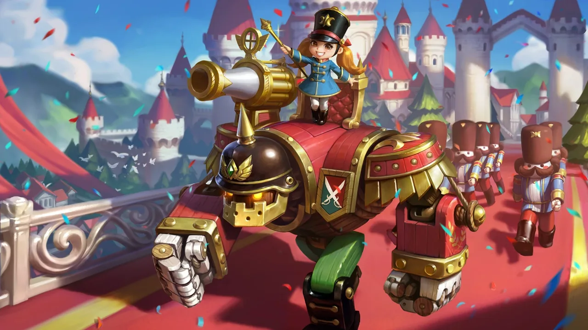

[Tier list](https://boostmlbb.ru/en/heroes/)[Items](https://boostmlbb.ru/en/items/)[Skins](https://boostmlbb.ru/en/skins/)[News & guides](https://boostmlbb.ru/en/news/)

[Skins](https://boostmlbb.ru/en/skins/)/[Jawhead](https://boostmlbb.ru/en/skins/jawhead.html)/The Nutcracker

[Jawhead skin](https://boostmlbb.ru/en/skins/jawhead.html)

# The Nutcracker

ExceptionalSpecialIn the shop

How to get

Sold in the skin shop for 749 diamonds.

Price

749 diamonds

Released

February 2019

## What the skin changes

-   New look
-   New skill effects
-   Showcase animation
-   Showcase scene
-   Attribute bonus

## Painted versions

The same skin in other colours. A painted version needs the skin itself.

-   **Field Commander**StarLight reward for October 2020.

## All Jawhead skins [9](https://boostmlbb.ru/en/skins/jawhead.html)

[Proto GuardianDeluxe · 2025](https://boostmlbb.ru/en/skins/jawhead/proto-guardian.html)[Victory LoaderCommon · 2024](https://boostmlbb.ru/en/skins/jawhead/victory-loader.html)[Cyber RangerExceptional · 2023](https://boostmlbb.ru/en/skins/jawhead/cyber-ranger.html)[Candy BearExceptional · 2021](https://boostmlbb.ru/en/skins/jawhead/candy-bear.html)[Samurai MechExquisite · 2020](https://boostmlbb.ru/en/skins/jawhead/samurai-mech.html)[Foo Quar­terbackCommon · 2019](https://boostmlbb.ru/en/skins/jawhead/foo-quarterback.html)[The NutcrackerExceptional · 2019](https://boostmlbb.ru/en/skins/jawhead/the-nutcracker.html)[Space ExplorerExceptional · 2018](https://boostmlbb.ru/en/skins/jawhead/space-explorer.html)[Girl ScoutCommon · 2018](https://boostmlbb.ru/en/skins/jawhead/girl-scout.html)

## Special series

[Arcane VerdictMathilda · 2026](https://boostmlbb.ru/en/skins/mathilda/arcane-verdict.html)[Windborne WaltzVale · 2026](https://boostmlbb.ru/en/skins/vale/windborne-waltz.html)[Captain of the LostFranco · 2026](https://boostmlbb.ru/en/skins/franco/captain-of-the-lost.html)[Waveb­reakerYi Sun-shin · 2025](https://boostmlbb.ru/en/skins/yi-sun-shin/wavebreaker.html)[Steel ArmsBadang · 2025](https://boostmlbb.ru/en/skins/badang/steel-arms.html)[Lady ParasolKagura · 2025](https://boostmlbb.ru/en/skins/kagura/lady-parasol.html)[Fathom TerrorAldous · 2025](https://boostmlbb.ru/en/skins/aldous/fathom-terror.html)[Moonglow TroupeChang'e · 2025](https://boostmlbb.ru/en/skins/change/moonglow-troupe.html)

**Rank up on Jawhead**The calculator shows the price

[Calculate price](https://boostmlbb.ru/en/order.html?type=hero)

## Frequently asked questions

How to get the The Nutcracker skin for Jawhead?

Sold in the skin shop for 749 diamonds.

When was The Nutcracker released?

February 2019.

What class is The Nutcracker?

Exceptional, Special series.
