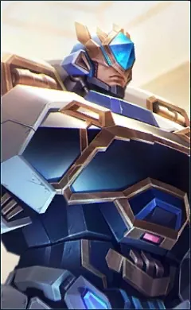

[Johnson skins](https://boostmlbb.ru/en/skins/johnson.html)

[Skins](https://boostmlbb.ru/en/skins/)/[Johnson](https://boostmlbb.ru/en/skins/johnson.html)/Optimus Prime

[Johnson skin](https://boostmlbb.ru/en/skins/johnson.html)

# Optimus Prime

GrandTransformersLimited

How to get

Released in the MLBB × Transformers event.

Released

7 October 2023

## What the skin changes

-   New look
-   New skill effects
-   Skill sounds
-   Voice-over
-   Skill icons
-   Showcase animation
-   Showcase scene
-   Attribute bonus

## All Johnson skins [8](https://boostmlbb.ru/en/skins/johnson.html)

[Sovereign of RealmsSupreme · 2025](https://boostmlbb.ru/en/skins/johnson/sovereign-of-realms.html)[Optimus PrimeGrand · 2023](https://boostmlbb.ru/en/skins/johnson/optimus-prime.html)[StarblazerExceptional · 2023](https://boostmlbb.ru/en/skins/johnson/starblazer.html)[Death RideExceptional · 2021](https://boostmlbb.ru/en/skins/johnson/death-ride.html)[Wreck KingExquisite · 2019](https://boostmlbb.ru/en/skins/johnson/wreck-king.html)[Jeepney RacerCommon · 2018](https://boostmlbb.ru/en/skins/johnson/jeepney-racer.html)[S.A.B.E.R. AutomataDeluxe · 2018](https://boostmlbb.ru/en/skins/johnson/s-a-b-e-r-automata.html)[Fire ChiefCommon · 2017](https://boostmlbb.ru/en/skins/johnson/fire-chief.html)

## Transformers series

[BumblebeeX.Borg · 2025](https://boostmlbb.ru/en/skins/x-borg/bumblebee.html)[MegatronGranger · 2023](https://boostmlbb.ru/en/skins/granger/megatron.html)[Soundwave & RavagePopol and Kupa · 2022](https://boostmlbb.ru/en/skins/popol-and-kupa/soundwave-ravage.html)[StarscreamAldous · 2022](https://boostmlbb.ru/en/skins/aldous/starscream.html)[GrimlockRoger · 2022](https://boostmlbb.ru/en/skins/roger/grimlock.html)

**How much is a rank boost on Johnson?**Choose your current and target ranks to see the price here.

[Calculate price](https://boostmlbb.ru/en/order.html?type=hero)

## Frequently asked questions

How to get the Optimus Prime skin for Johnson?

Released in the MLBB × Transformers event.

When was Optimus Prime released?

7 October 2023.

What class is Optimus Prime?

Grand, Transformers series.
