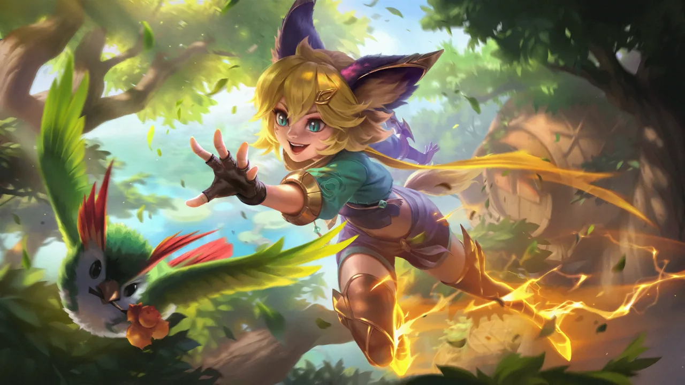

[All skins](https://boostmlbb.ru/en/skins/)

[Skins](https://boostmlbb.ru/en/skins/)/Joy

# Joy skins

Skins

3

In the shop

2

Latest

[Exostar Scout](https://boostmlbb.ru/en/skins/joy/exostar-scout.html)2025

[Hero profile→](https://boostmlbb.ru/en/heroes/joy.html)

## All skins

[Exostar ScoutExceptional · 2025](https://boostmlbb.ru/en/skins/joy/exostar-scout.html)[Royal ProtectorCommon · 2023](https://boostmlbb.ru/en/skins/joy/royal-protector.html)[Feline RangerCommon · 2022](https://boostmlbb.ru/en/skins/joy/feline-ranger.html)

**How much is a rank boost on Joy?**Choose your current and target ranks to see the price here.

[Calculate price](https://boostmlbb.ru/en/order.html?type=hero)

## Frequently asked questions

How many skins does Joy have?

3 skins, the default look not counted. The newest is Exostar Scout (1 April 2025).

Which Joy skins can you buy now?

Royal Protector (599 diamonds), Feline Ranger (269 diamonds). The other skins were limited and come back only in events.

What is the rarest Joy skin?

Exostar Scout, Exceptional class, StarLight series. StarLight reward for April 2025.
