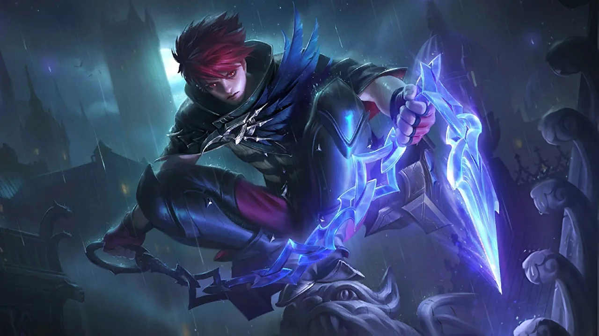

[Tier list](https://boostmlbb.ru/en/heroes/)[Items](https://boostmlbb.ru/en/items/)[Skins](https://boostmlbb.ru/en/skins/)[News & guides](https://boostmlbb.ru/en/news/)

[Skins](https://boostmlbb.ru/en/skins/)/Julian

# Julian skins

Skins

5

In the shop

1

Latest

[Meowkin Tracker](https://boostmlbb.ru/en/skins/julian/meowkin-tracker.html)2025

[Hero profile→](https://boostmlbb.ru/en/heroes/julian.html)

## All skins

[Meowkin TrackerDeluxe · 2025](https://boostmlbb.ru/en/skins/julian/meowkin-tracker.html)[KurapikaGrand · 2025](https://boostmlbb.ru/en/skins/julian/kurapika.html)[Megumi FushiguroGrand · 2023](https://boostmlbb.ru/en/skins/julian/megumi-fushiguro.html)[Silent EdgeCommon · 2022](https://boostmlbb.ru/en/skins/julian/silent-edge.html)[Itachi Uchiha](https://boostmlbb.ru/en/skins/julian/itachi-uchiha.html)

**Rank up on Julian**The calculator shows the price

[Calculate price](https://boostmlbb.ru/en/order.html?type=hero)

## Frequently asked questions

How many skins does Julian have?

5 skins, the default look not counted. The newest is Meowkin Tracker (6 August 2025).

Which Julian skins can you buy now?

Silent Edge (269 diamonds). The other skins were limited and come back only in events.

What is the rarest Julian skin?

Kurapika, Grand class, HUNTER×HUNTER series. Released in the MLBB × HUNTER×HUNTER event.
