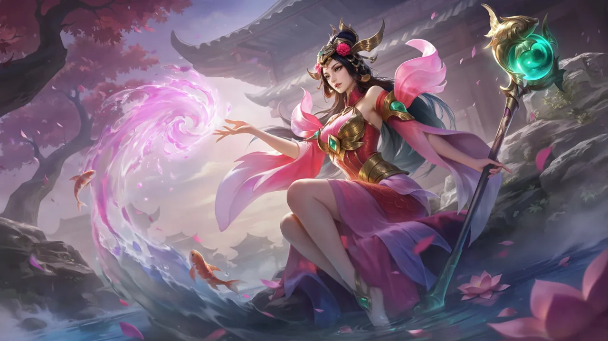

[Kadita skins](https://boostmlbb.ru/en/skins/kadita.html)

[Skins](https://boostmlbb.ru/en/skins/)/[Kadita](https://boostmlbb.ru/en/skins/kadita.html)/Anthem of Tides

[Kadita skin](https://boostmlbb.ru/en/skins/kadita.html)

# Anthem of Tides

EliteLimited

How to get

Released in the skin shop during an event. Limited skins come back in event draws from time to time.

## All Kadita skins [6](https://boostmlbb.ru/en/skins/kadita.html)

[Maiden of the TideExceptional · 2025](https://boostmlbb.ru/en/skins/kadita/maiden-of-the-tide.html)[Heart of the SeaDeluxe · 2024](https://boostmlbb.ru/en/skins/kadita/heart-of-the-sea.html)[Hydro­mancerExceptional · 2023](https://boostmlbb.ru/en/skins/kadita/hydromancer.html)[White RobinExceptional · 2019](https://boostmlbb.ru/en/skins/kadita/white-robin.html)[Atlantean PrincessCommon · 2018](https://boostmlbb.ru/en/skins/kadita/atlantean-princess.html)[Anthem of Tides](https://boostmlbb.ru/en/skins/kadita/anthem-of-tides.html)

## Elite series

[Golden OsmanthusChang'e · 2026](https://boostmlbb.ru/en/skins/change/golden-osmanthus.html)[Warlord KingMartis · 2025](https://boostmlbb.ru/en/skins/martis/warlord-king.html)[High Seas CadetKimmy · 2024](https://boostmlbb.ru/en/skins/kimmy/high-seas-cadet.html)[Verdant LancerSilvanna · 2024](https://boostmlbb.ru/en/skins/silvanna/verdant-lancer.html)[Bloodhoof MarauderHylos · 2024](https://boostmlbb.ru/en/skins/hylos/bloodhoof-marauder.html)[Elegant ButterflyGuinevere · 2024](https://boostmlbb.ru/en/skins/guinevere/elegant-butterfly.html)[Marques of BladesLancelot · 2024](https://boostmlbb.ru/en/skins/lancelot/marques-of-blades.html)[Badlands HiatusChip · 2024](https://boostmlbb.ru/en/skins/chip/badlands-hiatus.html)

**How much is a rank boost on Kadita?**Choose your current and target ranks to see the price here.

[Calculate price](https://boostmlbb.ru/en/order.html?type=hero)

## Frequently asked questions

How to get the Anthem of Tides skin for Kadita?

Released in the skin shop during an event. Limited skins come back in event draws from time to time.
