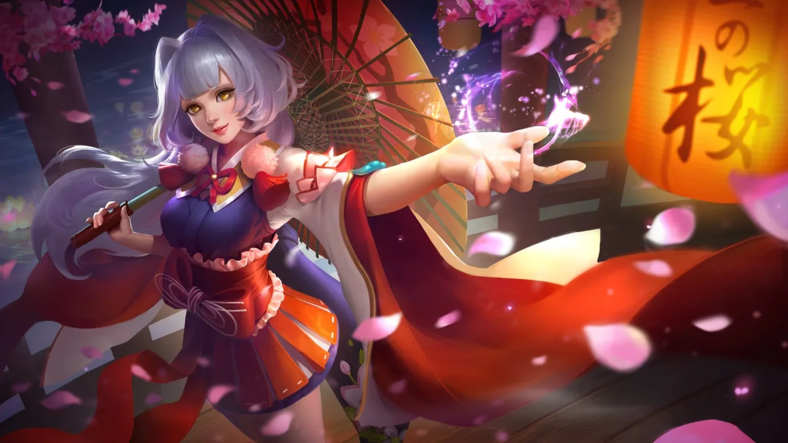

[Kagura skins](https://boostmlbb.ru/en/skins/kagura.html)

[Skins](https://boostmlbb.ru/en/skins/)/[Kagura](https://boostmlbb.ru/en/skins/kagura.html)/Cherry Witch

[Kagura skin](https://boostmlbb.ru/en/skins/kagura.html)

# Cherry Witch

ExceptionalSpecialIn the shop

How to get

Sold in the skin shop for 749 diamonds.

Price

749 diamonds

Released

2017

## What the skin changes

-   New look
-   New skill effects
-   Showcase animation
-   Attribute bonus

## Painted versions

The same skin in other colours. A painted version needs the skin itself.

-   **Amethyst Wizard**188 diamonds

## All Kagura skins [11](https://boostmlbb.ru/en/skins/kagura.html)

[Lady ParasolExceptional · 2025](https://boostmlbb.ru/en/skins/kagura/lady-parasol.html)[Jade BlossomDeluxe · 2024](https://boostmlbb.ru/en/skins/kagura/jade-blossom.html)[Beyond the Clouds KaguraExquisite · 2023](https://boostmlbb.ru/en/skins/kagura/beyond-the-clouds-kagura.html)[Exorcist KaguraGrand · 2022](https://boostmlbb.ru/en/skins/kagura/exorcist-kagura.html)[Water LilyExquisite · 2021](https://boostmlbb.ru/en/skins/kagura/water-lily.html)[Rainy WalkExceptional · 2021](https://boostmlbb.ru/en/skins/kagura/rainy-walk.html)[Summer FestivalExceptional · 2019](https://boostmlbb.ru/en/skins/kagura/summer-festival.html)[Dragon MaidenExquisite · 2018](https://boostmlbb.ru/en/skins/kagura/dragon-maiden.html)[Cherry WitchExceptional · 2017](https://boostmlbb.ru/en/skins/kagura/cherry-witch.html)[Flower SeasonCommon · 2016](https://boostmlbb.ru/en/skins/kagura/flower-season.html)[Feast of Eternity](https://boostmlbb.ru/en/skins/kagura/feast-of-eternity.html)

## Special series

[Arcane VerdictMathilda · 2026](https://boostmlbb.ru/en/skins/mathilda/arcane-verdict.html)[Windborne WaltzVale · 2026](https://boostmlbb.ru/en/skins/vale/windborne-waltz.html)[Captain of the LostFranco · 2026](https://boostmlbb.ru/en/skins/franco/captain-of-the-lost.html)[Waveb­reakerYi Sun-shin · 2025](https://boostmlbb.ru/en/skins/yi-sun-shin/wavebreaker.html)[Steel ArmsBadang · 2025](https://boostmlbb.ru/en/skins/badang/steel-arms.html)[Lady ParasolKagura · 2025](https://boostmlbb.ru/en/skins/kagura/lady-parasol.html)[Fathom TerrorAldous · 2025](https://boostmlbb.ru/en/skins/aldous/fathom-terror.html)[Moonglow TroupeChang'e · 2025](https://boostmlbb.ru/en/skins/change/moonglow-troupe.html)

**How much is a rank boost on Kagura?**Choose your current and target ranks to see the price here.

[Calculate price](https://boostmlbb.ru/en/order.html?type=hero)

## Frequently asked questions

How to get the Cherry Witch skin for Kagura?

Sold in the skin shop for 749 diamonds.

When was Cherry Witch released?

2017.

What class is Cherry Witch?

Exceptional, Special series.
