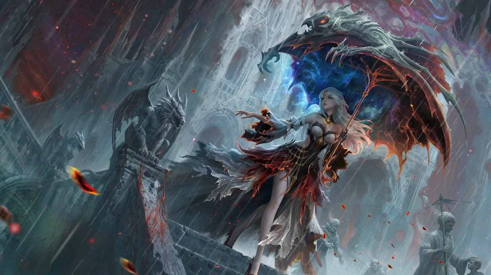
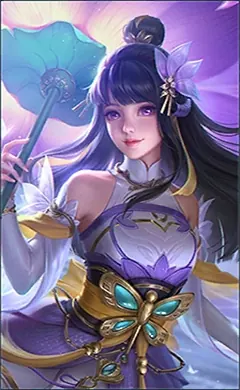
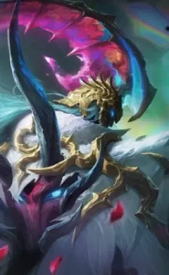

[Kagura skins](https://boostmlbb.ru/en/skins/kagura.html)

[Skins](https://boostmlbb.ru/en/skins/)/[Kagura](https://boostmlbb.ru/en/skins/kagura.html)/Feast of Eternity

[Kagura skin](https://boostmlbb.ru/en/skins/kagura.html)

# Feast of Eternity

LegendLimited

How to get

Exchanged for Magic Crystals from the Magic Wheel. Limited skins come back in event draws from time to time.

## All Kagura skins [11](https://boostmlbb.ru/en/skins/kagura.html)

[Lady ParasolExceptional · 2025](https://boostmlbb.ru/en/skins/kagura/lady-parasol.html)[Jade BlossomDeluxe · 2024](https://boostmlbb.ru/en/skins/kagura/jade-blossom.html)[Beyond the Clouds KaguraExquisite · 2023](https://boostmlbb.ru/en/skins/kagura/beyond-the-clouds-kagura.html)[Exorcist KaguraGrand · 2022](https://boostmlbb.ru/en/skins/kagura/exorcist-kagura.html)[Water LilyExquisite · 2021](https://boostmlbb.ru/en/skins/kagura/water-lily.html)[Rainy WalkExceptional · 2021](https://boostmlbb.ru/en/skins/kagura/rainy-walk.html)[Summer FestivalExceptional · 2019](https://boostmlbb.ru/en/skins/kagura/summer-festival.html)[Dragon MaidenExquisite · 2018](https://boostmlbb.ru/en/skins/kagura/dragon-maiden.html)[Cherry WitchExceptional · 2017](https://boostmlbb.ru/en/skins/kagura/cherry-witch.html)[Flower SeasonCommon · 2016](https://boostmlbb.ru/en/skins/kagura/flower-season.html)[Feast of Eternity](https://boostmlbb.ru/en/skins/kagura/feast-of-eternity.html)

## Legend series

[Revenant of RosesAlpha · 2025](https://boostmlbb.ru/en/skins/alpha/revenant-of-roses.html)[Sovereign of RealmsJohnson · 2025](https://boostmlbb.ru/en/skins/johnson/sovereign-of-realms.html)[Galactic VanquisherFreya · 2024](https://boostmlbb.ru/en/skins/freya/galactic-vanquisher.html)[Divine GoddessLunox · 2023](https://boostmlbb.ru/en/skins/lunox/divine-goddess.html)[King of HellFranco · 2023](https://boostmlbb.ru/en/skins/franco/king-of-hell.html)[Psion of TomorrowGuinevere · 2022](https://boostmlbb.ru/en/skins/guinevere/psion-of-tomorrow.html)[Infernal BlazeValir · 2022](https://boostmlbb.ru/en/skins/valir/infernal-blaze.html)[Cosmic GleamGusion · 2022](https://boostmlbb.ru/en/skins/gusion/cosmic-gleam.html)

**How much is a rank boost on Kagura?**Choose your current and target ranks to see the price here.

[Calculate price](https://boostmlbb.ru/en/order.html?type=hero)

## Frequently asked questions

How to get the Feast of Eternity skin for Kagura?

Exchanged for Magic Crystals from the Magic Wheel. Limited skins come back in event draws from time to time.
