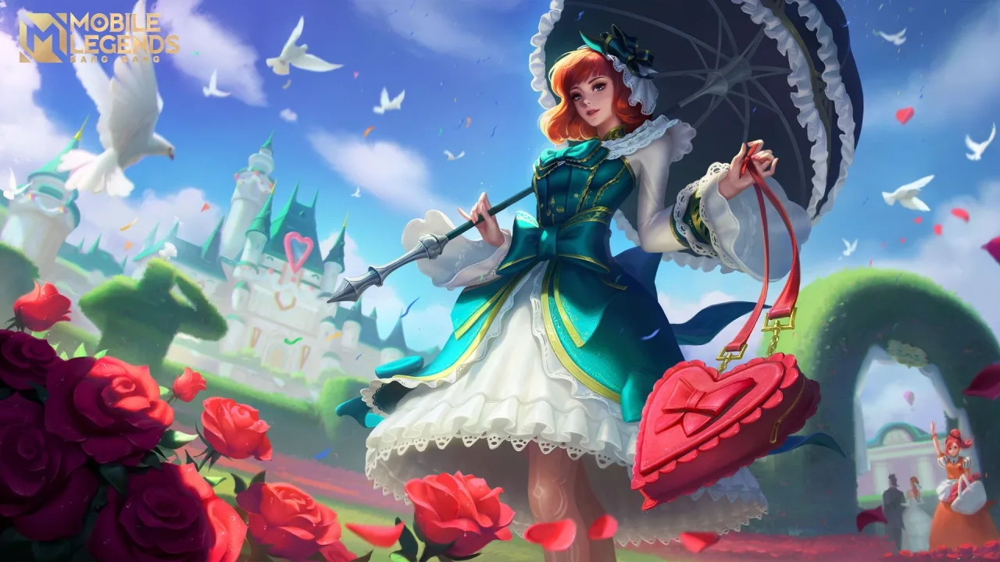

[Kagura skins](https://boostmlbb.ru/en/skins/kagura.html)

[Skins](https://boostmlbb.ru/en/skins/)/[Kagura](https://boostmlbb.ru/en/skins/kagura.html)/Flower Season

[Kagura skin](https://boostmlbb.ru/en/skins/kagura.html)

# Flower Season

CommonIn the shop

How to get

Sold in the skin shop for 269 diamonds.

Price

269 diamonds

Released

2016

## What the skin changes

-   Attribute bonus

## All Kagura skins [11](https://boostmlbb.ru/en/skins/kagura.html)

[Lady ParasolExceptional · 2025](https://boostmlbb.ru/en/skins/kagura/lady-parasol.html)[Jade BlossomDeluxe · 2024](https://boostmlbb.ru/en/skins/kagura/jade-blossom.html)[Beyond the Clouds KaguraExquisite · 2023](https://boostmlbb.ru/en/skins/kagura/beyond-the-clouds-kagura.html)[Exorcist KaguraGrand · 2022](https://boostmlbb.ru/en/skins/kagura/exorcist-kagura.html)[Water LilyExquisite · 2021](https://boostmlbb.ru/en/skins/kagura/water-lily.html)[Rainy WalkExceptional · 2021](https://boostmlbb.ru/en/skins/kagura/rainy-walk.html)[Summer FestivalExceptional · 2019](https://boostmlbb.ru/en/skins/kagura/summer-festival.html)[Dragon MaidenExquisite · 2018](https://boostmlbb.ru/en/skins/kagura/dragon-maiden.html)[Cherry WitchExceptional · 2017](https://boostmlbb.ru/en/skins/kagura/cherry-witch.html)[Flower SeasonCommon · 2016](https://boostmlbb.ru/en/skins/kagura/flower-season.html)[Feast of Eternity](https://boostmlbb.ru/en/skins/kagura/feast-of-eternity.html)

**How much is a rank boost on Kagura?**Choose your current and target ranks to see the price here.

[Calculate price](https://boostmlbb.ru/en/order.html?type=hero)

## Frequently asked questions

How to get the Flower Season skin for Kagura?

Sold in the skin shop for 269 diamonds.

When was Flower Season released?

2016.

What class is Flower Season?

Common.
