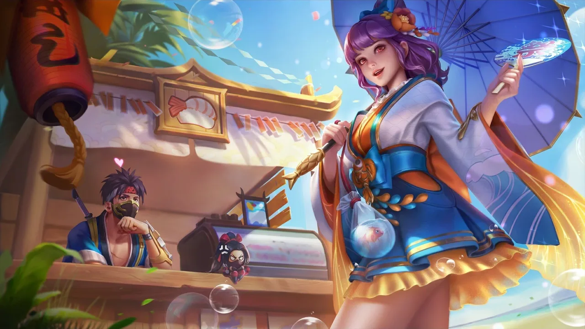

[Kagura skins](https://boostmlbb.ru/en/skins/kagura.html)

[Skins](https://boostmlbb.ru/en/skins/)/[Kagura](https://boostmlbb.ru/en/skins/kagura.html)/Summer Festival

[Kagura skin](https://boostmlbb.ru/en/skins/kagura.html)

# Summer Festival

ExceptionalSummerIn the shop

How to get

Sold in the skin shop for 749 diamonds.

Price

749 diamonds

Released

2019

## What the skin changes

-   New look
-   New skill effects
-   Showcase animation
-   Attribute bonus

## Painted versions

The same skin in other colours. A painted version needs the skin itself.

-   **Pink Summer Festival**188 diamonds

## All Kagura skins [11](https://boostmlbb.ru/en/skins/kagura.html)

[Lady ParasolExceptional · 2025](https://boostmlbb.ru/en/skins/kagura/lady-parasol.html)[Jade BlossomDeluxe · 2024](https://boostmlbb.ru/en/skins/kagura/jade-blossom.html)[Beyond the Clouds KaguraExquisite · 2023](https://boostmlbb.ru/en/skins/kagura/beyond-the-clouds-kagura.html)[Exorcist KaguraGrand · 2022](https://boostmlbb.ru/en/skins/kagura/exorcist-kagura.html)[Water LilyExquisite · 2021](https://boostmlbb.ru/en/skins/kagura/water-lily.html)[Rainy WalkExceptional · 2021](https://boostmlbb.ru/en/skins/kagura/rainy-walk.html)[Summer FestivalExceptional · 2019](https://boostmlbb.ru/en/skins/kagura/summer-festival.html)[Dragon MaidenExquisite · 2018](https://boostmlbb.ru/en/skins/kagura/dragon-maiden.html)[Cherry WitchExceptional · 2017](https://boostmlbb.ru/en/skins/kagura/cherry-witch.html)[Flower SeasonCommon · 2016](https://boostmlbb.ru/en/skins/kagura/flower-season.html)[Feast of Eternity](https://boostmlbb.ru/en/skins/kagura/feast-of-eternity.html)

## Summer series

[Summer SplashWanwan · 2025](https://boostmlbb.ru/en/skins/wanwan/summer-splash.html)[Yatai WaitressFloryn · 2024](https://boostmlbb.ru/en/skins/floryn/yatai-waitress.html)[Summer BreezeGuinevere · 2024](https://boostmlbb.ru/en/skins/guinevere/summer-breeze.html)[LifeguardClaude · 2024](https://boostmlbb.ru/en/skins/claude/lifeguard.html)[Summer WavesZilong · 2020](https://boostmlbb.ru/en/skins/zilong/summer-waves.html)[Summer VibesAngela · 2019](https://boostmlbb.ru/en/skins/angela/summer-vibes.html)[SundressNana · 2019](https://boostmlbb.ru/en/skins/nana/sundress.html)[Sushi MasterHayabusa · 2019](https://boostmlbb.ru/en/skins/hayabusa/sushi-master.html)

**How much is a rank boost on Kagura?**Choose your current and target ranks to see the price here.

[Calculate price](https://boostmlbb.ru/en/order.html?type=hero)

## Frequently asked questions

How to get the Summer Festival skin for Kagura?

Sold in the skin shop for 749 diamonds.

When was Summer Festival released?

2019.

What class is Summer Festival?

Exceptional, Summer series.
