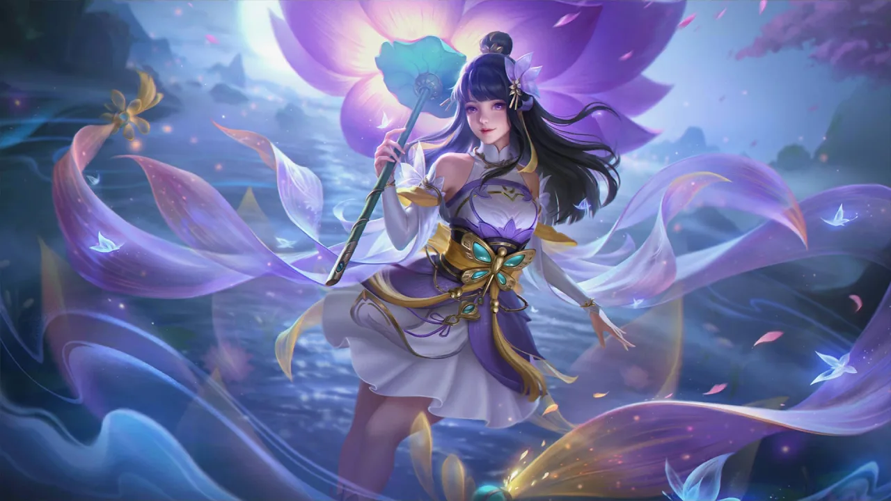

[Tier list](https://boostmlbb.ru/en/heroes/)[Items](https://boostmlbb.ru/en/items/)[Skins](https://boostmlbb.ru/en/skins/)[News & guides](https://boostmlbb.ru/en/news/)

[Skins](https://boostmlbb.ru/en/skins/)/[Kagura](https://boostmlbb.ru/en/skins/kagura.html)/Water Lily

[Kagura skin](https://boostmlbb.ru/en/skins/kagura.html)

# Water Lily

ExquisiteAnnual StarLightLimited

How to get

StarLight Fest 2021 event.

Released

November 2021

## What the skin changes

-   New look
-   New skill effects
-   Skill sounds
-   Voice-over
-   Showcase animation
-   Showcase scene
-   Special actions
-   Attribute bonus

## All Kagura skins [11](https://boostmlbb.ru/en/skins/kagura.html)

[Lady ParasolExceptional · 2025](https://boostmlbb.ru/en/skins/kagura/lady-parasol.html)[Jade BlossomDeluxe · 2024](https://boostmlbb.ru/en/skins/kagura/jade-blossom.html)[Beyond the Clouds KaguraExquisite · 2023](https://boostmlbb.ru/en/skins/kagura/beyond-the-clouds-kagura.html)[Exorcist KaguraGrand · 2022](https://boostmlbb.ru/en/skins/kagura/exorcist-kagura.html)[Water LilyExquisite · 2021](https://boostmlbb.ru/en/skins/kagura/water-lily.html)[Rainy WalkExceptional · 2021](https://boostmlbb.ru/en/skins/kagura/rainy-walk.html)[Summer FestivalExceptional · 2019](https://boostmlbb.ru/en/skins/kagura/summer-festival.html)[Dragon MaidenExquisite · 2018](https://boostmlbb.ru/en/skins/kagura/dragon-maiden.html)[Cherry WitchExceptional · 2017](https://boostmlbb.ru/en/skins/kagura/cherry-witch.html)[Flower SeasonCommon · 2016](https://boostmlbb.ru/en/skins/kagura/flower-season.html)[Feast of Eternity](https://boostmlbb.ru/en/skins/kagura/feast-of-eternity.html)

## Annual StarLight series

[Concerto of LightVale · 2024](https://boostmlbb.ru/en/skins/vale/concerto-of-light.html)[Avatar of TimeAngela · 2023](https://boostmlbb.ru/en/skins/angela/avatar-of-time.html)[Hawk-eyed SniperLesley · 2021](https://boostmlbb.ru/en/skins/lesley/hawk-eyed-sniper.html)[Neon LightwheelKarrie · 2020](https://boostmlbb.ru/en/skins/karrie/neon-lightwheel.html)[No.1 ControllerGord · 2019](https://boostmlbb.ru/en/skins/gord/no-1-controller.html)[Experiment 21Hayabusa · 2018](https://boostmlbb.ru/en/skins/hayabusa/experiment-21.html)

**Rank up on Kagura**The calculator shows the price

[Calculate price](https://boostmlbb.ru/en/order.html?type=hero)

## Frequently asked questions

How to get the Water Lily skin for Kagura?

StarLight Fest 2021 event.

When was Water Lily released?

November 2021.

What class is Water Lily?

Exquisite, Annual StarLight series.
