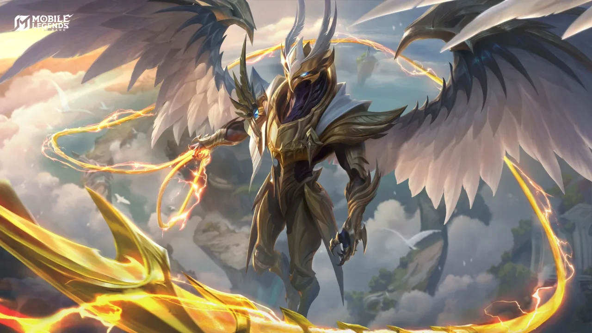

[Tier list](https://boostmlbb.ru/en/heroes/)[Items](https://boostmlbb.ru/en/items/)[Skins](https://boostmlbb.ru/en/skins/)[News & guides](https://boostmlbb.ru/en/news/)

[Skins](https://boostmlbb.ru/en/skins/)/Kaja

# Kaja skins

Skins

6

In the shop

2

Latest

[Inferno Taskmaster](https://boostmlbb.ru/en/skins/kaja/inferno-taskmaster.html)2023

[Hero profile→](https://boostmlbb.ru/en/heroes/kaja.html)

## All skins

[Inferno TaskmasterDeluxe · 2023](https://boostmlbb.ru/en/skins/kaja/inferno-taskmaster.html)[Crow MagicianCommon · 2020](https://boostmlbb.ru/en/skins/kaja/crow-magician.html)[SkyblockerExquisite · 2019](https://boostmlbb.ru/en/skins/kaja/skyblocker.html)[Horror WhiplashCommon · 2019](https://boostmlbb.ru/en/skins/kaja/horror-whiplash.html)[KaminariExceptional · 2019](https://boostmlbb.ru/en/skins/kaja/kaminari.html)[Com­mandmentCommon · 2018](https://boostmlbb.ru/en/skins/kaja/commandment.html)

**Rank up on Kaja**The calculator shows the price

[Calculate price](https://boostmlbb.ru/en/order.html?type=hero)

## Frequently asked questions

How many skins does Kaja have?

6 skins, the default look not counted. The newest is Inferno Taskmaster (28 September 2023).

Which Kaja skins can you buy now?

Horror Whiplash (599 diamonds), Commandment (269 diamonds). The other skins were limited and come back only in events.

What is the rarest Kaja skin?

Skyblocker, Exquisite class, Luckybox series. Came out of Lucky Boxes in events. Limited skins come back in event draws from time to time.
