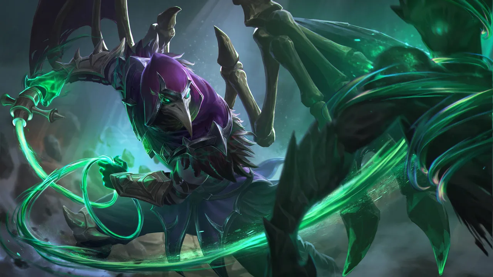
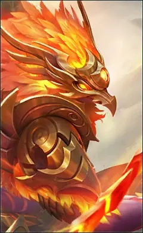
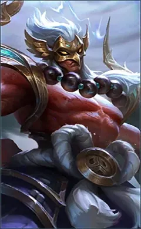

[Tier list](https://boostmlbb.ru/en/heroes/)[Items](https://boostmlbb.ru/en/items/)[Skins](https://boostmlbb.ru/en/skins/)[News & guides](https://boostmlbb.ru/en/news/)

[Skins](https://boostmlbb.ru/en/skins/)/[Kaja](https://boostmlbb.ru/en/skins/kaja.html)/Horror Whiplash

[Kaja skin](https://boostmlbb.ru/en/skins/kaja.html)

# Horror Whiplash

CommonEliteIn the shop

How to get

Sold in the skin shop for 599 diamonds.

Price

599 diamonds

Released

1 July 2019

## What the skin changes

-   New look
-   Recoloured effects
-   Showcase animation
-   Attribute bonus

## Painted versions

The same skin in other colours. A painted version needs the skin itself.

-   **Death Whiplash**StarLight reward for February 2021.

## All Kaja skins [6](https://boostmlbb.ru/en/skins/kaja.html)

[Inferno TaskmasterDeluxe · 2023](https://boostmlbb.ru/en/skins/kaja/inferno-taskmaster.html)[Crow MagicianCommon · 2020](https://boostmlbb.ru/en/skins/kaja/crow-magician.html)[SkyblockerExquisite · 2019](https://boostmlbb.ru/en/skins/kaja/skyblocker.html)[Horror WhiplashCommon · 2019](https://boostmlbb.ru/en/skins/kaja/horror-whiplash.html)[KaminariExceptional · 2019](https://boostmlbb.ru/en/skins/kaja/kaminari.html)[Com­mandmentCommon · 2018](https://boostmlbb.ru/en/skins/kaja/commandment.html)

## Elite series

[Golden OsmanthusChang'e · 2026](https://boostmlbb.ru/en/skins/change/golden-osmanthus.html)[Warlord KingMartis · 2025](https://boostmlbb.ru/en/skins/martis/warlord-king.html)[High Seas CadetKimmy · 2024](https://boostmlbb.ru/en/skins/kimmy/high-seas-cadet.html)[Verdant LancerSilvanna · 2024](https://boostmlbb.ru/en/skins/silvanna/verdant-lancer.html)[Bloodhoof MarauderHylos · 2024](https://boostmlbb.ru/en/skins/hylos/bloodhoof-marauder.html)[Elegant ButterflyGuinevere · 2024](https://boostmlbb.ru/en/skins/guinevere/elegant-butterfly.html)[Marques of BladesLancelot · 2024](https://boostmlbb.ru/en/skins/lancelot/marques-of-blades.html)[Badlands HiatusChip · 2024](https://boostmlbb.ru/en/skins/chip/badlands-hiatus.html)

**Rank up on Kaja**The calculator shows the price

[Calculate price](https://boostmlbb.ru/en/order.html?type=hero)

## Frequently asked questions

How to get the Horror Whiplash skin for Kaja?

Sold in the skin shop for 599 diamonds.

When was Horror Whiplash released?

1 July 2019.

What class is Horror Whiplash?

Common, Elite series.
