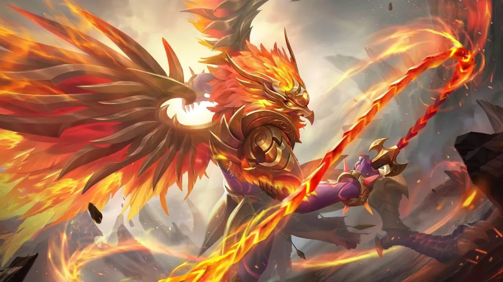

[Kaja skins](https://boostmlbb.ru/en/skins/kaja.html)

[Skins](https://boostmlbb.ru/en/skins/)/[Kaja](https://boostmlbb.ru/en/skins/kaja.html)/Inferno Taskmaster

[Kaja skin](https://boostmlbb.ru/en/skins/kaja.html)

# Inferno Taskmaster

DeluxeEpicLimited

How to get

Released in the skin shop during an event. Limited skins come back in event draws from time to time.

Released

28 September 2023

## What the skin changes

-   New look
-   New skill effects
-   Skill sounds
-   Showcase animation
-   Showcase scene
-   Attribute bonus

## All Kaja skins [6](https://boostmlbb.ru/en/skins/kaja.html)

[Inferno TaskmasterDeluxe · 2023](https://boostmlbb.ru/en/skins/kaja/inferno-taskmaster.html)[Crow MagicianCommon · 2020](https://boostmlbb.ru/en/skins/kaja/crow-magician.html)[SkyblockerExquisite · 2019](https://boostmlbb.ru/en/skins/kaja/skyblocker.html)[Horror WhiplashCommon · 2019](https://boostmlbb.ru/en/skins/kaja/horror-whiplash.html)[KaminariExceptional · 2019](https://boostmlbb.ru/en/skins/kaja/kaminari.html)[Com­mandmentCommon · 2018](https://boostmlbb.ru/en/skins/kaja/commandment.html)

## Epic series

[Nether OverseerMinotaur · 2026](https://boostmlbb.ru/en/skins/minotaur/nether-overseer.html)[Sunken CurseAtlas · 2026](https://boostmlbb.ru/en/skins/atlas/sunken-curse.html)[Eternal VowVexana · 2026](https://boostmlbb.ru/en/skins/vexana/eternal-vow.html)[Cursed ScrollKhufra · 2025](https://boostmlbb.ru/en/skins/khufra/cursed-scroll.html)[Soul HuntressNatalia · 2025](https://boostmlbb.ru/en/skins/natalia/soul-huntress.html)[Nightmare CountLeomord · 2025](https://boostmlbb.ru/en/skins/leomord/nightmare-count.html)[Arbiter of StarsBelerick · 2025](https://boostmlbb.ru/en/skins/belerick/arbiter-of-stars.html)[Keeper of the WindsVale · 2025](https://boostmlbb.ru/en/skins/vale/keeper-of-the-winds.html)

**How much is a rank boost on Kaja?**Choose your current and target ranks to see the price here.

[Calculate price](https://boostmlbb.ru/en/order.html?type=hero)

## Frequently asked questions

How to get the Inferno Taskmaster skin for Kaja?

Released in the skin shop during an event. Limited skins come back in event draws from time to time.

When was Inferno Taskmaster released?

28 September 2023.

What class is Inferno Taskmaster?

Deluxe, Epic series.
