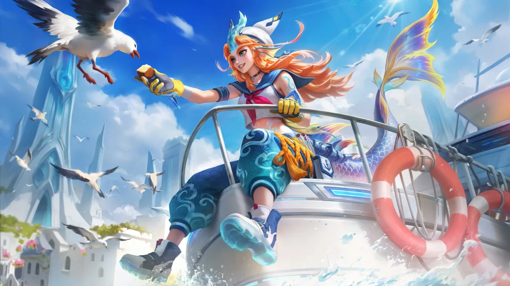

[Tier list](https://boostmlbb.ru/en/heroes/)[Items](https://boostmlbb.ru/en/items/)[Skins](https://boostmlbb.ru/en/skins/)[News & guides](https://boostmlbb.ru/en/news/)

[Skins](https://boostmlbb.ru/en/skins/)/[Kalea](https://boostmlbb.ru/en/skins/kalea.html)/Tideborn Sailor

[Kalea skin](https://boostmlbb.ru/en/skins/kalea.html)

# Tideborn Sailor

StarLightLimited

How to get

StarLight skin of November 2026: it was given for buying the StarLight pass that month. Limited skins come back in event draws from time to time.

Released

November 2026

## All Kalea skins [3](https://boostmlbb.ru/en/skins/kalea.html)

[Tideborn Sailor2026](https://boostmlbb.ru/en/skins/kalea/tideborn-sailor.html)[Sakura HarunoGrand · 2025](https://boostmlbb.ru/en/skins/kalea/sakura-haruno.html)[Shimmering WavesCommon · 2025](https://boostmlbb.ru/en/skins/kalea/shimmering-waves.html)

## StarLight series

[Kitsune's ShadowHayabusa · 2026](https://boostmlbb.ru/en/skins/hayabusa/kitsune-s-shadow.html)[Fangs of SlaughterHanzo · 2026](https://boostmlbb.ru/en/skins/hanzo/fangs-of-slaughter.html)[Smoul­dering FortressBelerick · 2026](https://boostmlbb.ru/en/skins/belerick/smouldering-fortress.html)[Magitech WraithObsidia · 2026](https://boostmlbb.ru/en/skins/obsidia/magitech-wraith.html)[Elysian LuminanceZetian · 2026](https://boostmlbb.ru/en/skins/zetian/elysian-luminance.html)[Guardian BattalionHilda · 2026](https://boostmlbb.ru/en/skins/hilda/guardian-battalion.html)[Dreaming KoiHarley · 2026](https://boostmlbb.ru/en/skins/harley/dreaming-koi.html)[Royal MarshalFredrinn · 2025](https://boostmlbb.ru/en/skins/fredrinn/royal-marshal.html)

**Rank up on Kalea**The calculator shows the price

[Calculate price](https://boostmlbb.ru/en/order.html?type=hero)

## Frequently asked questions

How to get the Tideborn Sailor skin for Kalea?

StarLight skin of November 2026: it was given for buying the StarLight pass that month. Limited skins come back in event draws from time to time.

When was Tideborn Sailor released?

November 2026.
