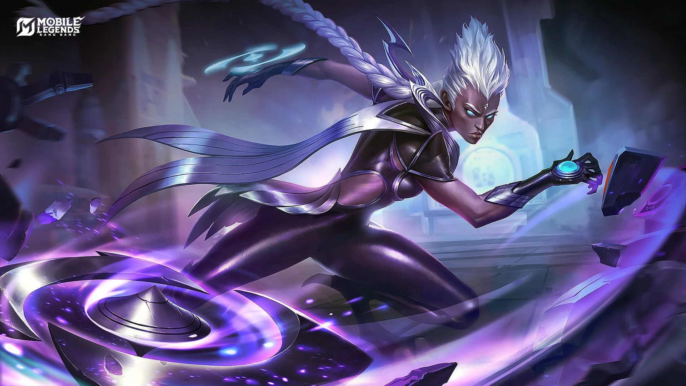

[All skins](https://boostmlbb.ru/en/skins/)

[Skins](https://boostmlbb.ru/en/skins/)/Karrie

# Karrie skins

Skins

10

In the shop

4

Latest

[Breath of Naraka](https://boostmlbb.ru/en/skins/karrie/breath-of-naraka.html)2025

[Hero profile→](https://boostmlbb.ru/en/heroes/karrie.html)

## All skins

AllGrandExquisiteDeluxeExceptionalCommon

[Breath of NarakaGrand · 2025](https://boostmlbb.ru/en/skins/karrie/breath-of-naraka.html)[Ice TalonDeluxe · 2023](https://boostmlbb.ru/en/skins/karrie/ice-talon.html)[Wheel of JusticeCommon · 2021](https://boostmlbb.ru/en/skins/karrie/wheel-of-justice.html)[Neon LightwheelExquisite · 2020](https://boostmlbb.ru/en/skins/karrie/neon-lightwheel.html)[Gill-GirlDeluxe · 2020](https://boostmlbb.ru/en/skins/karrie/gill-girl.html)[HawkwatchExquisite · 2019](https://boostmlbb.ru/en/skins/karrie/hawkwatch.html)[JesterExceptional · 2018](https://boostmlbb.ru/en/skins/karrie/jester.html)[Dragon QueenExceptional · 2018](https://boostmlbb.ru/en/skins/karrie/dragon-queen.html)[Rising StarCommon · 2017](https://boostmlbb.ru/en/skins/karrie/rising-star.html)[Bladed MantisCommon · 2017](https://boostmlbb.ru/en/skins/karrie/bladed-mantis.html)

**How much is a rank boost on Karrie?**Choose your current and target ranks to see the price here.

[Calculate price](https://boostmlbb.ru/en/order.html?type=hero)

## Frequently asked questions

How many skins does Karrie have?

10 skins, the default look not counted. The newest is Breath of Naraka (7 February 2025).

Which Karrie skins can you buy now?

Ice Talon (899 diamonds), Jester (749 diamonds), Rising Star (269 diamonds), Bladed Mantis (599 diamonds). The other skins were limited and come back only in events.

What is the rarest Karrie skin?

Breath of Naraka, Grand class, Kishin Densetsu series. Released in the Kishin Densetsu event. Limited skins come back in event draws from time to time.
