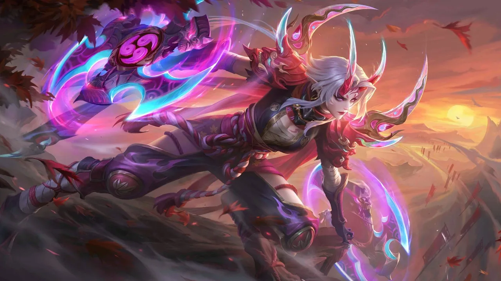

[Karrie skins](https://boostmlbb.ru/en/skins/karrie.html)

[Skins](https://boostmlbb.ru/en/skins/)/[Karrie](https://boostmlbb.ru/en/skins/karrie.html)/Breath of Naraka

[Karrie skin](https://boostmlbb.ru/en/skins/karrie.html)

# Breath of Naraka

GrandKishin DensetsuLimited

How to get

Released in the Kishin Densetsu event. Limited skins come back in event draws from time to time.

Released

7 February 2025

## What the skin changes

-   New look
-   New skill effects
-   Skill sounds
-   Voice-over
-   Skill icons
-   Showcase animation
-   Showcase scene
-   Showcase music
-   Spawn animation
-   Special actions
-   Attribute bonus

## All Karrie skins [10](https://boostmlbb.ru/en/skins/karrie.html)

[Breath of NarakaGrand · 2025](https://boostmlbb.ru/en/skins/karrie/breath-of-naraka.html)[Ice TalonDeluxe · 2023](https://boostmlbb.ru/en/skins/karrie/ice-talon.html)[Wheel of JusticeCommon · 2021](https://boostmlbb.ru/en/skins/karrie/wheel-of-justice.html)[Neon LightwheelExquisite · 2020](https://boostmlbb.ru/en/skins/karrie/neon-lightwheel.html)[Gill-GirlDeluxe · 2020](https://boostmlbb.ru/en/skins/karrie/gill-girl.html)[HawkwatchExquisite · 2019](https://boostmlbb.ru/en/skins/karrie/hawkwatch.html)[JesterExceptional · 2018](https://boostmlbb.ru/en/skins/karrie/jester.html)[Dragon QueenExceptional · 2018](https://boostmlbb.ru/en/skins/karrie/dragon-queen.html)[Rising StarCommon · 2017](https://boostmlbb.ru/en/skins/karrie/rising-star.html)[Bladed MantisCommon · 2017](https://boostmlbb.ru/en/skins/karrie/bladed-mantis.html)

## Kishin Densetsu series

[Strings of FateAngela · 2025](https://boostmlbb.ru/en/skins/angela/strings-of-fate.html)[Guardian of the ShrineLancelot · 2025](https://boostmlbb.ru/en/skins/lancelot/guardian-of-the-shrine.html)

**How much is a rank boost on Karrie?**Choose your current and target ranks to see the price here.

[Calculate price](https://boostmlbb.ru/en/order.html?type=hero)

## Frequently asked questions

How to get the Breath of Naraka skin for Karrie?

Released in the Kishin Densetsu event. Limited skins come back in event draws from time to time.

When was Breath of Naraka released?

7 February 2025.

What class is Breath of Naraka?

Grand, Kishin Densetsu series.
