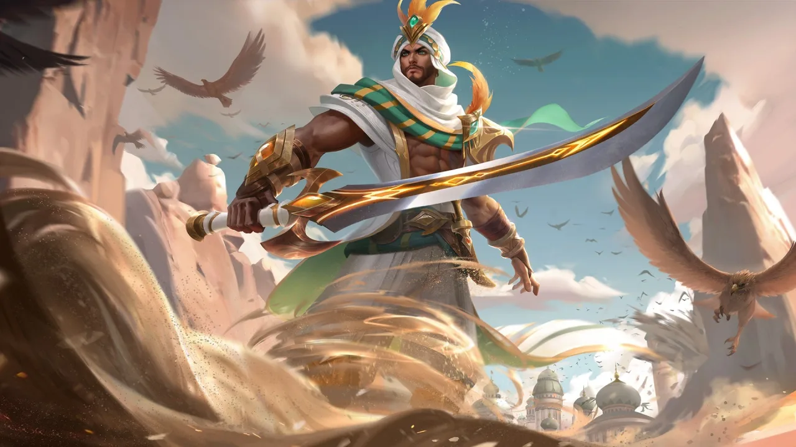

[All skins](https://boostmlbb.ru/en/skins/)

[Skins](https://boostmlbb.ru/en/skins/)/Khaleed

# Khaleed skins

Skins

4

In the shop

2

Latest

[Desert Salamander](https://boostmlbb.ru/en/skins/khaleed/desert-salamander.html)2025

[Hero profile→](https://boostmlbb.ru/en/heroes/khaleed.html)

## All skins

[Desert SalamanderCommon · 2025](https://boostmlbb.ru/en/skins/khaleed/desert-salamander.html)[Wave StriderDeluxe · 2024](https://boostmlbb.ru/en/skins/khaleed/wave-strider.html)[Crescent ScimitarCommon · 2021](https://boostmlbb.ru/en/skins/khaleed/crescent-scimitar.html)[Prince of SandCommon · 2020](https://boostmlbb.ru/en/skins/khaleed/prince-of-sand.html)

**How much is a rank boost on Khaleed?**Choose your current and target ranks to see the price here.

[Calculate price](https://boostmlbb.ru/en/order.html?type=hero)

## Frequently asked questions

How many skins does Khaleed have?

4 skins, the default look not counted. The newest is Desert Salamander (19 March 2025).

Which Khaleed skins can you buy now?

Wave Strider (899 diamonds), Prince of Sand (269 diamonds). The other skins were limited and come back only in events.

What is the rarest Khaleed skin?

Wave Strider, Deluxe class, Epic series. Sold in the skin shop for 899 diamonds.
