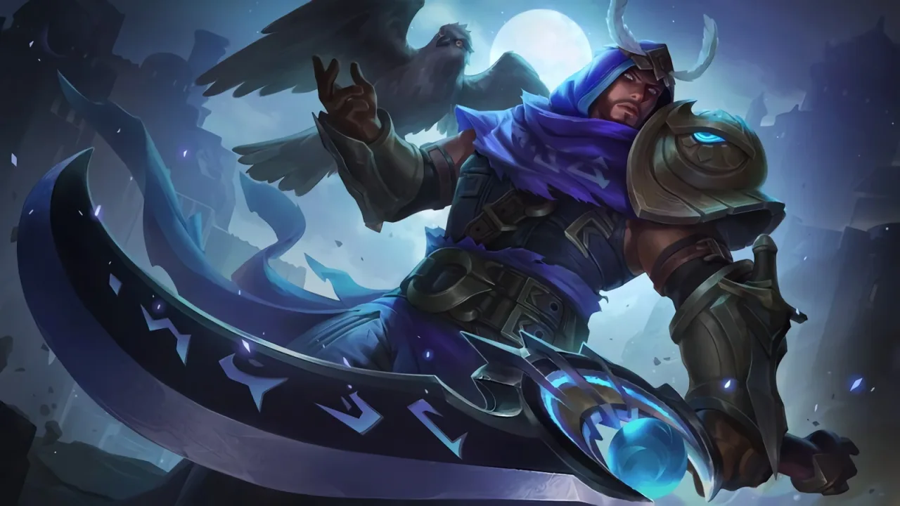

[Khaleed skins](https://boostmlbb.ru/en/skins/khaleed.html)

[Skins](https://boostmlbb.ru/en/skins/)/[Khaleed](https://boostmlbb.ru/en/skins/khaleed.html)/Crescent Scimitar

[Khaleed skin](https://boostmlbb.ru/en/skins/khaleed.html)

# Crescent Scimitar

CommonEliteLimited

How to get

Price at release: 599 diamonds. Not sold in the shop now: it comes back only in events.

Price

599 diamonds

Released

12 March 2021

## What the skin changes

-   New look
-   Recoloured effects
-   Showcase animation
-   Attribute bonus

## All Khaleed skins [4](https://boostmlbb.ru/en/skins/khaleed.html)

[Desert SalamanderCommon · 2025](https://boostmlbb.ru/en/skins/khaleed/desert-salamander.html)[Wave StriderDeluxe · 2024](https://boostmlbb.ru/en/skins/khaleed/wave-strider.html)[Crescent ScimitarCommon · 2021](https://boostmlbb.ru/en/skins/khaleed/crescent-scimitar.html)[Prince of SandCommon · 2020](https://boostmlbb.ru/en/skins/khaleed/prince-of-sand.html)

## Elite series

[Golden OsmanthusChang'e · 2026](https://boostmlbb.ru/en/skins/change/golden-osmanthus.html)[Warlord KingMartis · 2025](https://boostmlbb.ru/en/skins/martis/warlord-king.html)[High Seas CadetKimmy · 2024](https://boostmlbb.ru/en/skins/kimmy/high-seas-cadet.html)[Verdant LancerSilvanna · 2024](https://boostmlbb.ru/en/skins/silvanna/verdant-lancer.html)[Bloodhoof MarauderHylos · 2024](https://boostmlbb.ru/en/skins/hylos/bloodhoof-marauder.html)[Elegant ButterflyGuinevere · 2024](https://boostmlbb.ru/en/skins/guinevere/elegant-butterfly.html)[Marques of BladesLancelot · 2024](https://boostmlbb.ru/en/skins/lancelot/marques-of-blades.html)[Badlands HiatusChip · 2024](https://boostmlbb.ru/en/skins/chip/badlands-hiatus.html)

**How much is a rank boost on Khaleed?**Choose your current and target ranks to see the price here.

[Calculate price](https://boostmlbb.ru/en/order.html?type=hero)

## Frequently asked questions

How to get the Crescent Scimitar skin for Khaleed?

Price at release: 599 diamonds. Not sold in the shop now: it comes back only in events.

When was Crescent Scimitar released?

12 March 2021.

What class is Crescent Scimitar?

Common, Elite series.
