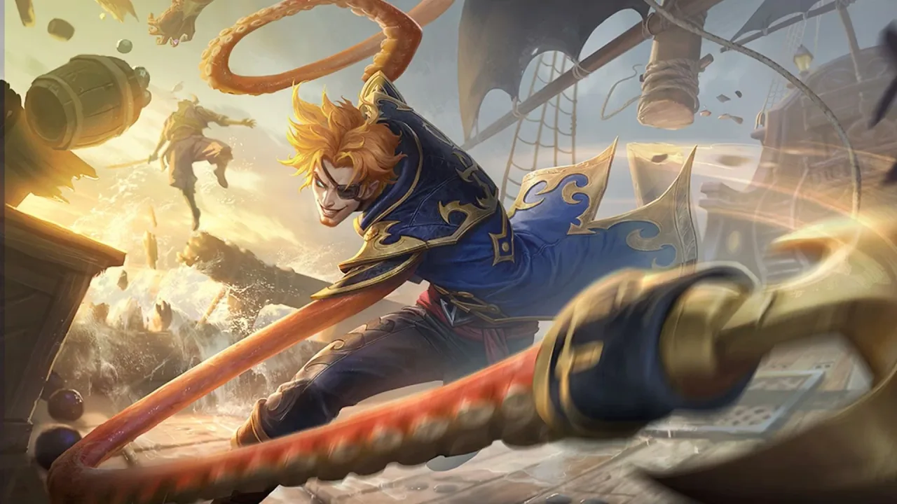

[Khufra skins](https://boostmlbb.ru/en/skins/khufra.html)

[Skins](https://boostmlbb.ru/en/skins/)/[Khufra](https://boostmlbb.ru/en/skins/khufra.html)/Iron Hook

[Khufra skin](https://boostmlbb.ru/en/skins/khufra.html)

# Iron Hook

CommonEliteLimited

How to get

First top-up gift in Season 28.

Released

1 November 2023

## What the skin changes

-   New look
-   Recoloured effects
-   Showcase animation
-   Attribute bonus

## All Khufra skins [7](https://boostmlbb.ru/en/skins/khufra.html)

[Cursed ScrollDeluxe · 2025](https://boostmlbb.ru/en/skins/khufra/cursed-scroll.html)[Iron HookCommon · 2023](https://boostmlbb.ru/en/skins/khufra/iron-hook.html)[Gentleman ThiefExceptional · 2023](https://boostmlbb.ru/en/skins/khufra/gentleman-thief.html)[ApophisCommon · 2023](https://boostmlbb.ru/en/skins/khufra/apophis.html)[Dreadful ClownExceptional · 2021](https://boostmlbb.ru/en/skins/khufra/dreadful-clown.html)[Volcanic OverlordExquisite · 2020](https://boostmlbb.ru/en/skins/khufra/volcanic-overlord.html)[Desert OwlCommon · 2019](https://boostmlbb.ru/en/skins/khufra/desert-owl.html)

## Elite series

[Golden OsmanthusChang'e · 2026](https://boostmlbb.ru/en/skins/change/golden-osmanthus.html)[Warlord KingMartis · 2025](https://boostmlbb.ru/en/skins/martis/warlord-king.html)[High Seas CadetKimmy · 2024](https://boostmlbb.ru/en/skins/kimmy/high-seas-cadet.html)[Verdant LancerSilvanna · 2024](https://boostmlbb.ru/en/skins/silvanna/verdant-lancer.html)[Bloodhoof MarauderHylos · 2024](https://boostmlbb.ru/en/skins/hylos/bloodhoof-marauder.html)[Elegant ButterflyGuinevere · 2024](https://boostmlbb.ru/en/skins/guinevere/elegant-butterfly.html)[Marques of BladesLancelot · 2024](https://boostmlbb.ru/en/skins/lancelot/marques-of-blades.html)[Badlands HiatusChip · 2024](https://boostmlbb.ru/en/skins/chip/badlands-hiatus.html)

**How much is a rank boost on Khufra?**Choose your current and target ranks to see the price here.

[Calculate price](https://boostmlbb.ru/en/order.html?type=hero)

## Frequently asked questions

How to get the Iron Hook skin for Khufra?

First top-up gift in Season 28.

When was Iron Hook released?

1 November 2023.

What class is Iron Hook?

Common, Elite series.
