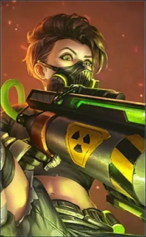

[Tier list](https://boostmlbb.ru/en/heroes/)[Items](https://boostmlbb.ru/en/items/)[Skins](https://boostmlbb.ru/en/skins/)[News & guides](https://boostmlbb.ru/en/news/)

[Skins](https://boostmlbb.ru/en/skins/)/[Kimmy](https://boostmlbb.ru/en/skins/kimmy.html)/Astrocat

[Kimmy skin](https://boostmlbb.ru/en/skins/kimmy.html)

# Astrocat

ExquisiteLuckyboxLimited

How to get

Came out of Lucky Boxes in events. Limited skins come back in event draws from time to time.

Released

1 March 2018

## What the skin changes

-   New look
-   New skill effects
-   Showcase animation
-   Showcase scene
-   Attribute bonus

## All Kimmy skins [9](https://boostmlbb.ru/en/skins/kimmy.html)

[Starbound Sentry2026](https://boostmlbb.ru/en/skins/kimmy/starbound-sentry.html)[Frost WingDeluxe · 2025](https://boostmlbb.ru/en/skins/kimmy/frost-wing.html)[Rising NovaExceptional · 2025](https://boostmlbb.ru/en/skins/kimmy/rising-nova.html)[High Seas CadetCommon · 2024](https://boostmlbb.ru/en/skins/kimmy/high-seas-cadet.html)[First Order Jet TrooperGrand · 2023](https://boostmlbb.ru/en/skins/kimmy/first-order-jet-trooper.html)[Steam ResearcherCommon · 2022](https://boostmlbb.ru/en/skins/kimmy/steam-researcher.html)[Bio FrontierExceptional · 2019](https://boostmlbb.ru/en/skins/kimmy/bio-frontier.html)[Charge LeaderExceptional · 2018](https://boostmlbb.ru/en/skins/kimmy/charge-leader.html)[AstrocatExquisite · 2018](https://boostmlbb.ru/en/skins/kimmy/astrocat.html)

## Luckybox series

[Lady CraneGuinevere · 2025](https://boostmlbb.ru/en/skins/guinevere/lady-crane.html)[Butterfly SeraphimLunox · 2025](https://boostmlbb.ru/en/skins/lunox/butterfly-seraphim.html)[Mecha DragonClaude · 2025](https://boostmlbb.ru/en/skins/claude/mecha-dragon.html)[Lunar MagicChang'e · 2020](https://boostmlbb.ru/en/skins/change/lunar-magic.html)[Thunder FlashSelena · 2020](https://boostmlbb.ru/en/skins/selena/thunder-flash.html)[RaksheshaHanabi · 2020](https://boostmlbb.ru/en/skins/hanabi/rakshesha.html)[Video-Game DominatorUranus · 2020](https://boostmlbb.ru/en/skins/uranus/video-game-dominator.html)[God of WarMartis · 2020](https://boostmlbb.ru/en/skins/martis/god-of-war.html)

**Rank up on Kimmy**The calculator shows the price

[Calculate price](https://boostmlbb.ru/en/order.html?type=hero)

## Frequently asked questions

How to get the Astrocat skin for Kimmy?

Came out of Lucky Boxes in events. Limited skins come back in event draws from time to time.

When was Astrocat released?

1 March 2018.

What class is Astrocat?

Exquisite, Luckybox series.
