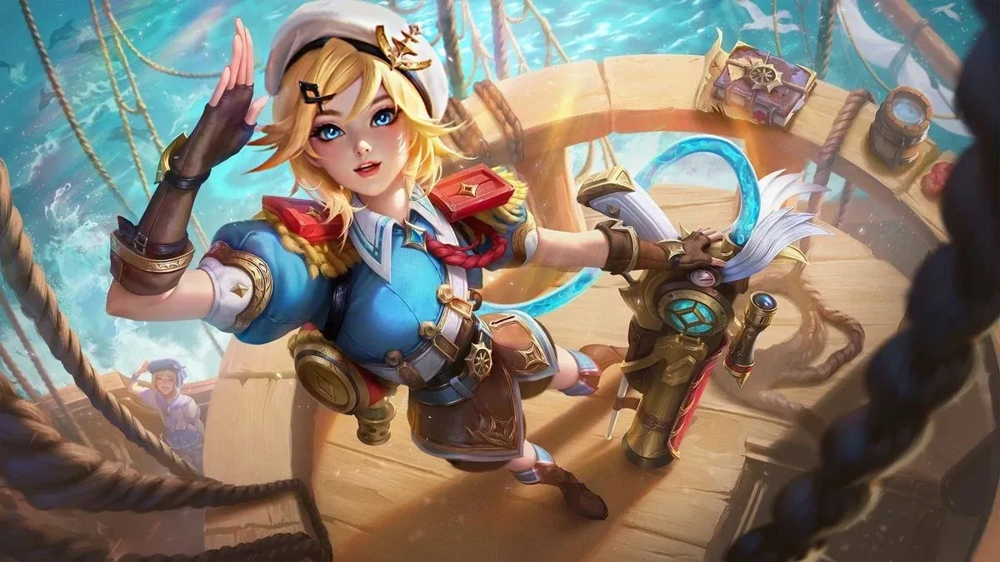

[Tier list](https://boostmlbb.ru/en/heroes/)[Items](https://boostmlbb.ru/en/items/)[Skins](https://boostmlbb.ru/en/skins/)[News & guides](https://boostmlbb.ru/en/news/)

[Skins](https://boostmlbb.ru/en/skins/)/[Kimmy](https://boostmlbb.ru/en/skins/kimmy.html)/High Seas Cadet

[Kimmy skin](https://boostmlbb.ru/en/skins/kimmy.html)

# High Seas Cadet

CommonEliteLimited

How to get

First top-up gift in Season 35.

Released

21 December 2024

## What the skin changes

-   New look
-   Recoloured effects
-   Showcase animation
-   Attribute bonus

## All Kimmy skins [9](https://boostmlbb.ru/en/skins/kimmy.html)

[Starbound Sentry2026](https://boostmlbb.ru/en/skins/kimmy/starbound-sentry.html)[Frost WingDeluxe · 2025](https://boostmlbb.ru/en/skins/kimmy/frost-wing.html)[Rising NovaExceptional · 2025](https://boostmlbb.ru/en/skins/kimmy/rising-nova.html)[High Seas CadetCommon · 2024](https://boostmlbb.ru/en/skins/kimmy/high-seas-cadet.html)[First Order Jet TrooperGrand · 2023](https://boostmlbb.ru/en/skins/kimmy/first-order-jet-trooper.html)[Steam ResearcherCommon · 2022](https://boostmlbb.ru/en/skins/kimmy/steam-researcher.html)[Bio FrontierExceptional · 2019](https://boostmlbb.ru/en/skins/kimmy/bio-frontier.html)[Charge LeaderExceptional · 2018](https://boostmlbb.ru/en/skins/kimmy/charge-leader.html)[AstrocatExquisite · 2018](https://boostmlbb.ru/en/skins/kimmy/astrocat.html)

## Elite series

[Golden OsmanthusChang'e · 2026](https://boostmlbb.ru/en/skins/change/golden-osmanthus.html)[Warlord KingMartis · 2025](https://boostmlbb.ru/en/skins/martis/warlord-king.html)[Verdant LancerSilvanna · 2024](https://boostmlbb.ru/en/skins/silvanna/verdant-lancer.html)[Bloodhoof MarauderHylos · 2024](https://boostmlbb.ru/en/skins/hylos/bloodhoof-marauder.html)[Elegant ButterflyGuinevere · 2024](https://boostmlbb.ru/en/skins/guinevere/elegant-butterfly.html)[Marques of BladesLancelot · 2024](https://boostmlbb.ru/en/skins/lancelot/marques-of-blades.html)[Badlands HiatusChip · 2024](https://boostmlbb.ru/en/skins/chip/badlands-hiatus.html)[Star MagicianHarley · 2024](https://boostmlbb.ru/en/skins/harley/star-magician.html)

**Rank up on Kimmy**The calculator shows the price

[Calculate price](https://boostmlbb.ru/en/order.html?type=hero)

## Frequently asked questions

How to get the High Seas Cadet skin for Kimmy?

First top-up gift in Season 35.

When was High Seas Cadet released?

21 December 2024.

What class is High Seas Cadet?

Common, Elite series.
