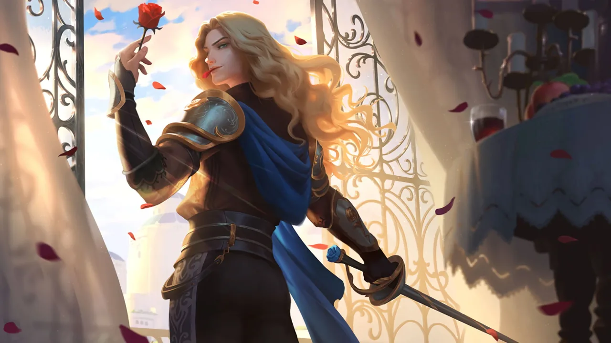

[All skins](https://boostmlbb.ru/en/skins/)

[Skins](https://boostmlbb.ru/en/skins/)/Lancelot

# Lancelot skins

Skins

12

In the shop

3

Latest

[Blade of Devotion](https://boostmlbb.ru/en/skins/lancelot/blade-of-devotion.html)2026

[Hero profile→](https://boostmlbb.ru/en/heroes/lancelot.html)

## All skins

AllGrandExquisiteDeluxeExceptionalCommon

[Blade of DevotionExquisite · 2026](https://boostmlbb.ru/en/skins/lancelot/blade-of-devotion.html)[Guardian of the ShrineGrand · 2025](https://boostmlbb.ru/en/skins/lancelot/guardian-of-the-shrine.html)[SwordmasterGrand · 2024](https://boostmlbb.ru/en/skins/lancelot/swordmaster.html)[Marques of BladesCommon · 2024](https://boostmlbb.ru/en/skins/lancelot/marques-of-blades.html)[Empyrean FlameDeluxe · 2021](https://boostmlbb.ru/en/skins/lancelot/empyrean-flame.html)[Bren EsportsDeluxe · 2020](https://boostmlbb.ru/en/skins/lancelot/bren-esports.html)[Floral KnightDeluxe · 2019](https://boostmlbb.ru/en/skins/lancelot/floral-knight.html)[PiscesDeluxe · 2019](https://boostmlbb.ru/en/skins/lancelot/pisces.html)[Royal MatadorExquisite · 2018](https://boostmlbb.ru/en/skins/lancelot/royal-matador.html)[Dark EarlExceptional · 2018](https://boostmlbb.ru/en/skins/lancelot/dark-earl.html)[Christmas CarnivalExceptional · 2018](https://boostmlbb.ru/en/skins/lancelot/christmas-carnival.html)[Masked KnightCommon · 2018](https://boostmlbb.ru/en/skins/lancelot/masked-knight.html)

**How much is a rank boost on Lancelot?**Choose your current and target ranks to see the price here.

[Calculate price](https://boostmlbb.ru/en/order.html?type=hero)

## Frequently asked questions

How many skins does Lancelot have?

12 skins, the default look not counted. The newest is Blade of Devotion (1 February 2026).

Which Lancelot skins can you buy now?

Empyrean Flame (899 diamonds), Floral Knight (899 diamonds), Masked Knight (269 diamonds). The other skins were limited and come back only in events.

What is the rarest Lancelot skin?

Guardian of the Shrine, Grand class, Kishin Densetsu series. Released in the Kishin Densetsu event. Limited skins come back in event draws from time to time.
