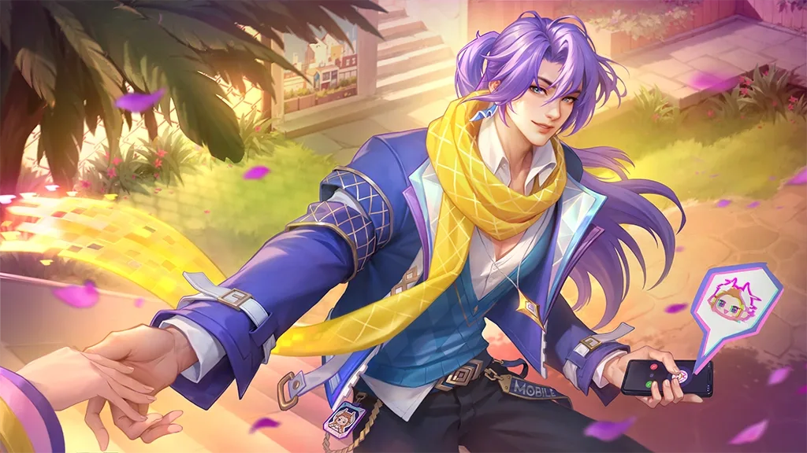

[Lancelot skins](https://boostmlbb.ru/en/skins/lancelot.html)

[Skins](https://boostmlbb.ru/en/skins/)/[Lancelot](https://boostmlbb.ru/en/skins/lancelot.html)/Blade of Devotion

[Lancelot skin](https://boostmlbb.ru/en/skins/lancelot.html)

# Blade of Devotion

ExquisiteValentine 2026Limited

How to get

Released in the skin shop during an event. Limited skins come back in event draws from time to time.

Released

1 February 2026

## What the skin changes

-   New look
-   New skill effects
-   Skill sounds
-   Voice-over
-   Showcase animation
-   Showcase scene
-   Showcase music
-   Special actions
-   Attribute bonus

## All Lancelot skins [12](https://boostmlbb.ru/en/skins/lancelot.html)

[Blade of DevotionExquisite · 2026](https://boostmlbb.ru/en/skins/lancelot/blade-of-devotion.html)[Guardian of the ShrineGrand · 2025](https://boostmlbb.ru/en/skins/lancelot/guardian-of-the-shrine.html)[SwordmasterGrand · 2024](https://boostmlbb.ru/en/skins/lancelot/swordmaster.html)[Marques of BladesCommon · 2024](https://boostmlbb.ru/en/skins/lancelot/marques-of-blades.html)[Empyrean FlameDeluxe · 2021](https://boostmlbb.ru/en/skins/lancelot/empyrean-flame.html)[Bren EsportsDeluxe · 2020](https://boostmlbb.ru/en/skins/lancelot/bren-esports.html)[Floral KnightDeluxe · 2019](https://boostmlbb.ru/en/skins/lancelot/floral-knight.html)[PiscesDeluxe · 2019](https://boostmlbb.ru/en/skins/lancelot/pisces.html)[Royal MatadorExquisite · 2018](https://boostmlbb.ru/en/skins/lancelot/royal-matador.html)[Dark EarlExceptional · 2018](https://boostmlbb.ru/en/skins/lancelot/dark-earl.html)[Christmas CarnivalExceptional · 2018](https://boostmlbb.ru/en/skins/lancelot/christmas-carnival.html)[Masked KnightCommon · 2018](https://boostmlbb.ru/en/skins/lancelot/masked-knight.html)

## Valentine 2026 series

[Song of DevotionOdette · 2026](https://boostmlbb.ru/en/skins/odette/song-of-devotion.html)

**How much is a rank boost on Lancelot?**Choose your current and target ranks to see the price here.

[Calculate price](https://boostmlbb.ru/en/order.html?type=hero)

## Frequently asked questions

How to get the Blade of Devotion skin for Lancelot?

Released in the skin shop during an event. Limited skins come back in event draws from time to time.

When was Blade of Devotion released?

1 February 2026.

What class is Blade of Devotion?

Exquisite, Valentine 2026 series.
