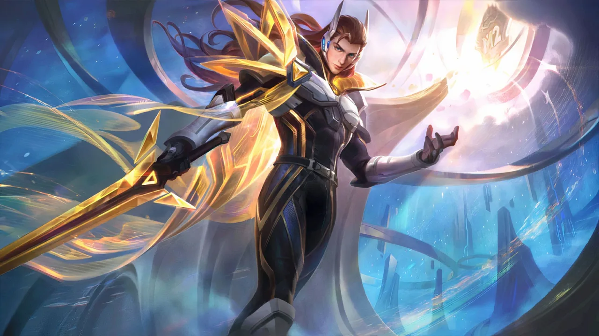

[Lancelot skins](https://boostmlbb.ru/en/skins/lancelot.html)

[Skins](https://boostmlbb.ru/en/skins/)/[Lancelot](https://boostmlbb.ru/en/skins/lancelot.html)/Bren Esports

[Lancelot skin](https://boostmlbb.ru/en/skins/lancelot.html)

# Bren Esports

DeluxeChampionLimited

How to get

Esports skin of Champion: it was released in the tournament event. Limited skins come back in event draws from time to time.

Released

3 November 2020

## What the skin changes

-   New look
-   New skill effects
-   Skill sounds
-   Showcase animation
-   Showcase scene
-   Attribute bonus

## All Lancelot skins [12](https://boostmlbb.ru/en/skins/lancelot.html)

[Blade of DevotionExquisite · 2026](https://boostmlbb.ru/en/skins/lancelot/blade-of-devotion.html)[Guardian of the ShrineGrand · 2025](https://boostmlbb.ru/en/skins/lancelot/guardian-of-the-shrine.html)[SwordmasterGrand · 2024](https://boostmlbb.ru/en/skins/lancelot/swordmaster.html)[Marques of BladesCommon · 2024](https://boostmlbb.ru/en/skins/lancelot/marques-of-blades.html)[Empyrean FlameDeluxe · 2021](https://boostmlbb.ru/en/skins/lancelot/empyrean-flame.html)[Bren EsportsDeluxe · 2020](https://boostmlbb.ru/en/skins/lancelot/bren-esports.html)[Floral KnightDeluxe · 2019](https://boostmlbb.ru/en/skins/lancelot/floral-knight.html)[PiscesDeluxe · 2019](https://boostmlbb.ru/en/skins/lancelot/pisces.html)[Royal MatadorExquisite · 2018](https://boostmlbb.ru/en/skins/lancelot/royal-matador.html)[Dark EarlExceptional · 2018](https://boostmlbb.ru/en/skins/lancelot/dark-earl.html)[Christmas CarnivalExceptional · 2018](https://boostmlbb.ru/en/skins/lancelot/christmas-carnival.html)[Masked KnightCommon · 2018](https://boostmlbb.ru/en/skins/lancelot/masked-knight.html)

## Champion series

[EVOS LegendsHarith · 2025](https://boostmlbb.ru/en/skins/harith/evos-legends.html)[APBrenBrody · 2024](https://boostmlbb.ru/en/skins/brody/apbren.html)[Blacklist Interna­tionalEstes · 2024](https://boostmlbb.ru/en/skins/estes/blacklist-international.html)[ECHOChou · 2023](https://boostmlbb.ru/en/skins/chou/echo.html)

**How much is a rank boost on Lancelot?**Choose your current and target ranks to see the price here.

[Calculate price](https://boostmlbb.ru/en/order.html?type=hero)

## Frequently asked questions

How to get the Bren Esports skin for Lancelot?

Esports skin of Champion: it was released in the tournament event. Limited skins come back in event draws from time to time.

When was Bren Esports released?

3 November 2020.

What class is Bren Esports?

Deluxe, Champion series.
