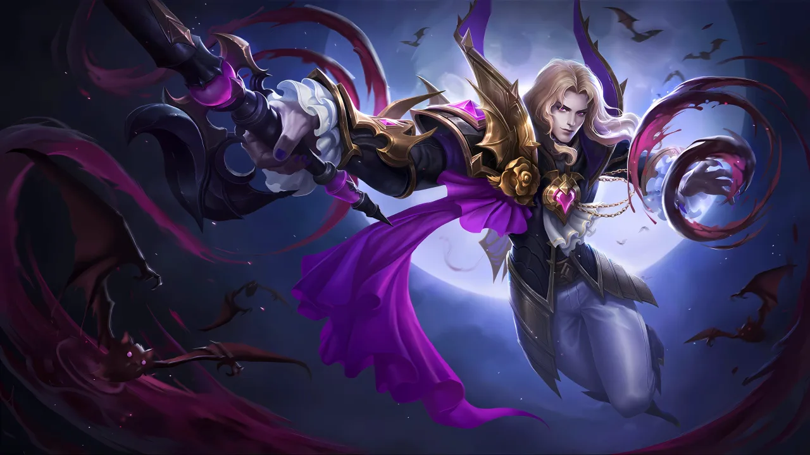

[Lancelot skins](https://boostmlbb.ru/en/skins/lancelot.html)

[Skins](https://boostmlbb.ru/en/skins/)/[Lancelot](https://boostmlbb.ru/en/skins/lancelot.html)/Dark Earl

[Lancelot skin](https://boostmlbb.ru/en/skins/lancelot.html)

# Dark Earl

ExceptionalStarLightLimited

How to get

StarLight reward for August 2018.

Released

1 August 2018

## What the skin changes

-   New look
-   New skill effects
-   Showcase animation
-   Attribute bonus

## All Lancelot skins [12](https://boostmlbb.ru/en/skins/lancelot.html)

[Blade of DevotionExquisite · 2026](https://boostmlbb.ru/en/skins/lancelot/blade-of-devotion.html)[Guardian of the ShrineGrand · 2025](https://boostmlbb.ru/en/skins/lancelot/guardian-of-the-shrine.html)[SwordmasterGrand · 2024](https://boostmlbb.ru/en/skins/lancelot/swordmaster.html)[Marques of BladesCommon · 2024](https://boostmlbb.ru/en/skins/lancelot/marques-of-blades.html)[Empyrean FlameDeluxe · 2021](https://boostmlbb.ru/en/skins/lancelot/empyrean-flame.html)[Bren EsportsDeluxe · 2020](https://boostmlbb.ru/en/skins/lancelot/bren-esports.html)[Floral KnightDeluxe · 2019](https://boostmlbb.ru/en/skins/lancelot/floral-knight.html)[PiscesDeluxe · 2019](https://boostmlbb.ru/en/skins/lancelot/pisces.html)[Royal MatadorExquisite · 2018](https://boostmlbb.ru/en/skins/lancelot/royal-matador.html)[Dark EarlExceptional · 2018](https://boostmlbb.ru/en/skins/lancelot/dark-earl.html)[Christmas CarnivalExceptional · 2018](https://boostmlbb.ru/en/skins/lancelot/christmas-carnival.html)[Masked KnightCommon · 2018](https://boostmlbb.ru/en/skins/lancelot/masked-knight.html)

## StarLight series

[Tideborn SailorKalea · 2026](https://boostmlbb.ru/en/skins/kalea/tideborn-sailor.html)[Kitsune's ShadowHayabusa · 2026](https://boostmlbb.ru/en/skins/hayabusa/kitsune-s-shadow.html)[Fangs of SlaughterHanzo · 2026](https://boostmlbb.ru/en/skins/hanzo/fangs-of-slaughter.html)[Smoul­dering FortressBelerick · 2026](https://boostmlbb.ru/en/skins/belerick/smouldering-fortress.html)[Magitech WraithObsidia · 2026](https://boostmlbb.ru/en/skins/obsidia/magitech-wraith.html)[Elysian LuminanceZetian · 2026](https://boostmlbb.ru/en/skins/zetian/elysian-luminance.html)[Guardian BattalionHilda · 2026](https://boostmlbb.ru/en/skins/hilda/guardian-battalion.html)[Dreaming KoiHarley · 2026](https://boostmlbb.ru/en/skins/harley/dreaming-koi.html)

**How much is a rank boost on Lancelot?**Choose your current and target ranks to see the price here.

[Calculate price](https://boostmlbb.ru/en/order.html?type=hero)

## Frequently asked questions

How to get the Dark Earl skin for Lancelot?

StarLight reward for August 2018.

When was Dark Earl released?

1 August 2018.

What class is Dark Earl?

Exceptional, StarLight series.
