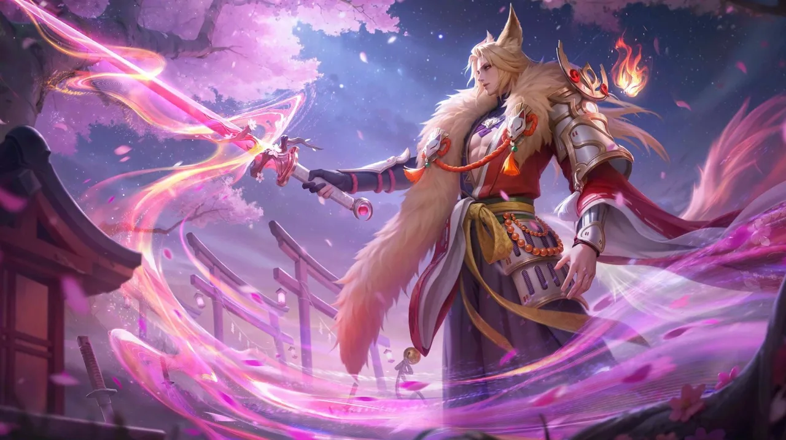
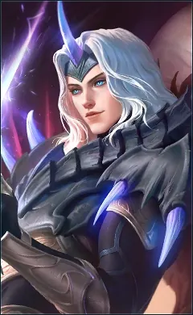

[Tier list](https://boostmlbb.ru/en/heroes/)[Items](https://boostmlbb.ru/en/items/)[Skins](https://boostmlbb.ru/en/skins/)[News & guides](https://boostmlbb.ru/en/news/)

[Skins](https://boostmlbb.ru/en/skins/)/[Lancelot](https://boostmlbb.ru/en/skins/lancelot.html)/Guardian of the Shrine

[Lancelot skin](https://boostmlbb.ru/en/skins/lancelot.html)

# Guardian of the Shrine

GrandKishin DensetsuLimited

How to get

Released in the Kishin Densetsu event. Limited skins come back in event draws from time to time.

Released

7 February 2025

## What the skin changes

-   New look
-   New skill effects
-   Skill sounds
-   Voice-over
-   Skill icons
-   Showcase animation
-   Showcase scene
-   Showcase music
-   Spawn animation
-   Special actions
-   Attribute bonus

## All Lancelot skins [12](https://boostmlbb.ru/en/skins/lancelot.html)

[Blade of DevotionExquisite · 2026](https://boostmlbb.ru/en/skins/lancelot/blade-of-devotion.html)[Guardian of the ShrineGrand · 2025](https://boostmlbb.ru/en/skins/lancelot/guardian-of-the-shrine.html)[SwordmasterGrand · 2024](https://boostmlbb.ru/en/skins/lancelot/swordmaster.html)[Marques of BladesCommon · 2024](https://boostmlbb.ru/en/skins/lancelot/marques-of-blades.html)[Empyrean FlameDeluxe · 2021](https://boostmlbb.ru/en/skins/lancelot/empyrean-flame.html)[Bren EsportsDeluxe · 2020](https://boostmlbb.ru/en/skins/lancelot/bren-esports.html)[Floral KnightDeluxe · 2019](https://boostmlbb.ru/en/skins/lancelot/floral-knight.html)[PiscesDeluxe · 2019](https://boostmlbb.ru/en/skins/lancelot/pisces.html)[Royal MatadorExquisite · 2018](https://boostmlbb.ru/en/skins/lancelot/royal-matador.html)[Dark EarlExceptional · 2018](https://boostmlbb.ru/en/skins/lancelot/dark-earl.html)[Christmas CarnivalExceptional · 2018](https://boostmlbb.ru/en/skins/lancelot/christmas-carnival.html)[Masked KnightCommon · 2018](https://boostmlbb.ru/en/skins/lancelot/masked-knight.html)

## Kishin Densetsu series

[Strings of FateAngela · 2025](https://boostmlbb.ru/en/skins/angela/strings-of-fate.html)[Breath of NarakaKarrie · 2025](https://boostmlbb.ru/en/skins/karrie/breath-of-naraka.html)

**Rank up on Lancelot**The calculator shows the price

[Calculate price](https://boostmlbb.ru/en/order.html?type=hero)

## Frequently asked questions

How to get the Guardian of the Shrine skin for Lancelot?

Released in the Kishin Densetsu event. Limited skins come back in event draws from time to time.

When was Guardian of the Shrine released?

7 February 2025.

What class is Guardian of the Shrine?

Grand, Kishin Densetsu series.
