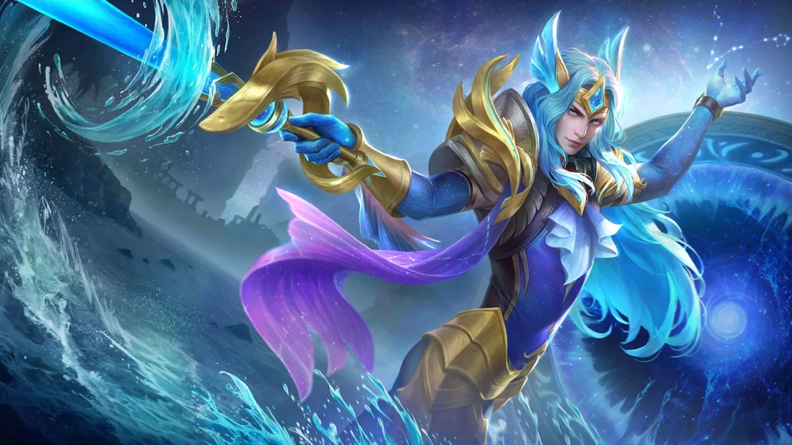

[Tier list](https://boostmlbb.ru/en/heroes/)[Items](https://boostmlbb.ru/en/items/)[Skins](https://boostmlbb.ru/en/skins/)[News & guides](https://boostmlbb.ru/en/news/)

[Skins](https://boostmlbb.ru/en/skins/)/[Lancelot](https://boostmlbb.ru/en/skins/lancelot.html)/Pisces

[Lancelot skin](https://boostmlbb.ru/en/skins/lancelot.html)

# Pisces

DeluxeZodiacLimited

How to get

Drawn in the Zodiac Summon.

Released

13 February 2019

## What the skin changes

-   New look
-   New skill effects
-   Skill sounds
-   Voice-over
-   Showcase animation
-   Showcase scene
-   Attribute bonus

## All Lancelot skins [12](https://boostmlbb.ru/en/skins/lancelot.html)

[Blade of DevotionExquisite · 2026](https://boostmlbb.ru/en/skins/lancelot/blade-of-devotion.html)[Guardian of the ShrineGrand · 2025](https://boostmlbb.ru/en/skins/lancelot/guardian-of-the-shrine.html)[SwordmasterGrand · 2024](https://boostmlbb.ru/en/skins/lancelot/swordmaster.html)[Marques of BladesCommon · 2024](https://boostmlbb.ru/en/skins/lancelot/marques-of-blades.html)[Empyrean FlameDeluxe · 2021](https://boostmlbb.ru/en/skins/lancelot/empyrean-flame.html)[Bren EsportsDeluxe · 2020](https://boostmlbb.ru/en/skins/lancelot/bren-esports.html)[Floral KnightDeluxe · 2019](https://boostmlbb.ru/en/skins/lancelot/floral-knight.html)[PiscesDeluxe · 2019](https://boostmlbb.ru/en/skins/lancelot/pisces.html)[Royal MatadorExquisite · 2018](https://boostmlbb.ru/en/skins/lancelot/royal-matador.html)[Dark EarlExceptional · 2018](https://boostmlbb.ru/en/skins/lancelot/dark-earl.html)[Christmas CarnivalExceptional · 2018](https://boostmlbb.ru/en/skins/lancelot/christmas-carnival.html)[Masked KnightCommon · 2018](https://boostmlbb.ru/en/skins/lancelot/masked-knight.html)

## Zodiac series

[CapricornMartis · 2022](https://boostmlbb.ru/en/skins/martis/capricorn.html)[ScorpioHelcurt · 2019](https://boostmlbb.ru/en/skins/helcurt/scorpio.html)[LibraLunox · 2019](https://boostmlbb.ru/en/skins/lunox/libra.html)[LeoBadang · 2019](https://boostmlbb.ru/en/skins/badang/leo.html)[CancerZhask · 2019](https://boostmlbb.ru/en/skins/zhask/cancer.html)[Gemini - ShadowSelena · 2019](https://boostmlbb.ru/en/skins/selena/gemini-shadow.html)[Gemini - HaloKarina · 2019](https://boostmlbb.ru/en/skins/karina/gemini-halo.html)[TaurusMinotaur · 2019](https://boostmlbb.ru/en/skins/minotaur/taurus.html)

**Rank up on Lancelot**The calculator shows the price

[Calculate price](https://boostmlbb.ru/en/order.html?type=hero)

## Frequently asked questions

How to get the Pisces skin for Lancelot?

Drawn in the Zodiac Summon.

When was Pisces released?

13 February 2019.

What class is Pisces?

Deluxe, Zodiac series.
