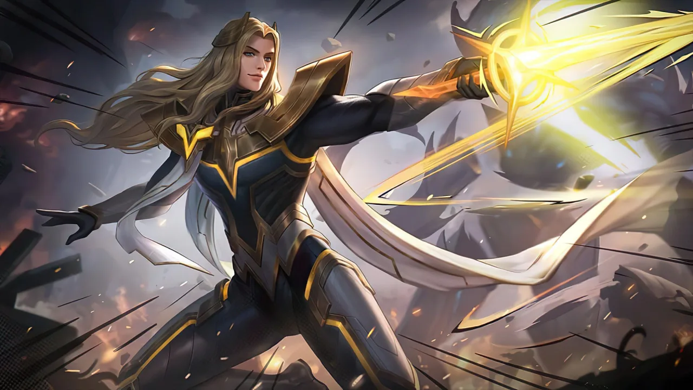
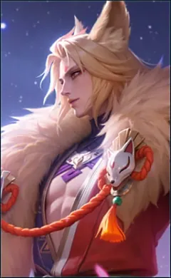

[Tier list](https://boostmlbb.ru/en/heroes/)[Items](https://boostmlbb.ru/en/items/)[Skins](https://boostmlbb.ru/en/skins/)[News & guides](https://boostmlbb.ru/en/news/)

[Skins](https://boostmlbb.ru/en/skins/)/[Lancelot](https://boostmlbb.ru/en/skins/lancelot.html)/Swordmaster

[Lancelot skin](https://boostmlbb.ru/en/skins/lancelot.html)

# Swordmaster

GrandDawning StarsLimited

How to get

Released in the Dawning Stars event. Limited skins come back in event draws from time to time.

Released

5 March 2024

## What the skin changes

-   New look
-   New skill effects
-   Skill sounds
-   Voice-over
-   Showcase animation
-   Showcase scene
-   Attribute bonus

## All Lancelot skins [12](https://boostmlbb.ru/en/skins/lancelot.html)

[Blade of DevotionExquisite · 2026](https://boostmlbb.ru/en/skins/lancelot/blade-of-devotion.html)[Guardian of the ShrineGrand · 2025](https://boostmlbb.ru/en/skins/lancelot/guardian-of-the-shrine.html)[SwordmasterGrand · 2024](https://boostmlbb.ru/en/skins/lancelot/swordmaster.html)[Marques of BladesCommon · 2024](https://boostmlbb.ru/en/skins/lancelot/marques-of-blades.html)[Empyrean FlameDeluxe · 2021](https://boostmlbb.ru/en/skins/lancelot/empyrean-flame.html)[Bren EsportsDeluxe · 2020](https://boostmlbb.ru/en/skins/lancelot/bren-esports.html)[Floral KnightDeluxe · 2019](https://boostmlbb.ru/en/skins/lancelot/floral-knight.html)[PiscesDeluxe · 2019](https://boostmlbb.ru/en/skins/lancelot/pisces.html)[Royal MatadorExquisite · 2018](https://boostmlbb.ru/en/skins/lancelot/royal-matador.html)[Dark EarlExceptional · 2018](https://boostmlbb.ru/en/skins/lancelot/dark-earl.html)[Christmas CarnivalExceptional · 2018](https://boostmlbb.ru/en/skins/lancelot/christmas-carnival.html)[Masked KnightCommon · 2018](https://boostmlbb.ru/en/skins/lancelot/masked-knight.html)

## Dawning Stars series

[Blizzard StormVale · 2023](https://boostmlbb.ru/en/skins/vale/blizzard-storm.html)[The ForeseerEsmeralda · 2023](https://boostmlbb.ru/en/skins/esmeralda/the-foreseer.html)[Thun­derfistChou · 2021](https://boostmlbb.ru/en/skins/chou/thunderfist.html)[FireboltBruno · 2020](https://boostmlbb.ru/en/skins/bruno/firebolt.html)

**Rank up on Lancelot**The calculator shows the price

[Calculate price](https://boostmlbb.ru/en/order.html?type=hero)

## Frequently asked questions

How to get the Swordmaster skin for Lancelot?

Released in the Dawning Stars event. Limited skins come back in event draws from time to time.

When was Swordmaster released?

5 March 2024.

What class is Swordmaster?

Grand, Dawning Stars series.
