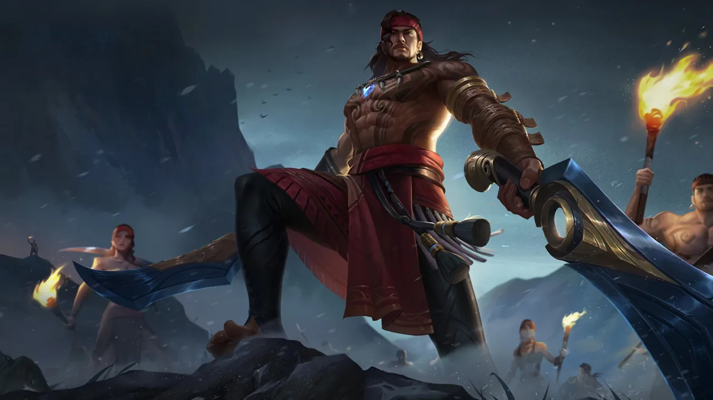

[All skins](https://boostmlbb.ru/en/skins/)

[Skins](https://boostmlbb.ru/en/skins/)/Lapu-Lapu

# Lapu-Lapu skins

Skins

6

In the shop

2

Latest

[Adlaw's Chosen](https://boostmlbb.ru/en/skins/lapu-lapu/adlaw-s-chosen.html)2024

[Hero profile→](https://boostmlbb.ru/en/heroes/lapu-lapu.html)

## All skins

[Adlaw's ChosenExquisite · 2024](https://boostmlbb.ru/en/skins/lapu-lapu/adlaw-s-chosen.html)[Son of the WildCommon · 2022](https://boostmlbb.ru/en/skins/lapu-lapu/son-of-the-wild.html)[Special ForceExceptional · 2021](https://boostmlbb.ru/en/skins/lapu-lapu/special-force.html)[VulcanExceptional · 2019](https://boostmlbb.ru/en/skins/lapu-lapu/vulcan.html)[Ancestral BladeCommon · 2017](https://boostmlbb.ru/en/skins/lapu-lapu/ancestral-blade.html)[Imperial ChampionCommon · 2017](https://boostmlbb.ru/en/skins/lapu-lapu/imperial-champion.html)

**How much is a rank boost on Lapu-Lapu?**Choose your current and target ranks to see the price here.

[Calculate price](https://boostmlbb.ru/en/order.html?type=hero)

## Frequently asked questions

How many skins does Lapu-Lapu have?

6 skins, the default look not counted. The newest is Adlaw's Chosen (January 2024).

Which Lapu-Lapu skins can you buy now?

Ancestral Blade (269 diamonds), Imperial Champion (599 diamonds). The other skins were limited and come back only in events.

What is the rarest Lapu-Lapu skin?

Adlaw's Chosen, Exquisite class, Collector series. The top prize of a Collector event draw, paid with diamonds. Limited skins come back in event draws from time to time.
