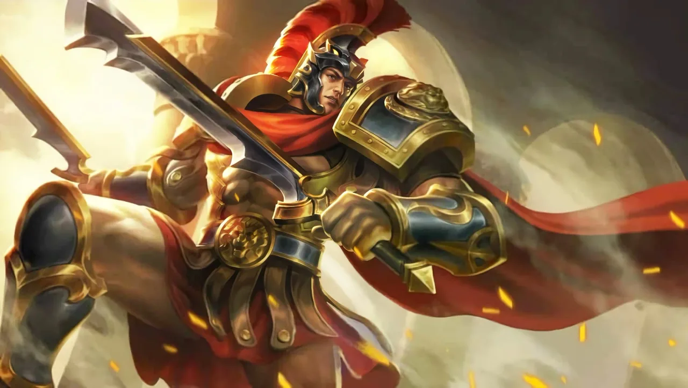
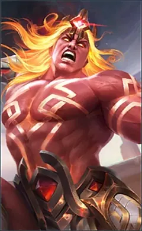

[Tier list](https://boostmlbb.ru/en/heroes/)[Items](https://boostmlbb.ru/en/items/)[Skins](https://boostmlbb.ru/en/skins/)[News & guides](https://boostmlbb.ru/en/news/)

[Skins](https://boostmlbb.ru/en/skins/)/[Lapu-Lapu](https://boostmlbb.ru/en/skins/lapu-lapu.html)/Imperial Champion

[Lapu-Lapu skin](https://boostmlbb.ru/en/skins/lapu-lapu.html)

# Imperial Champion

CommonEliteIn the shop

How to get

Sold in the skin shop for 599 diamonds.

Price

599 diamonds

Released

2017

## What the skin changes

-   New look
-   Recoloured effects
-   Showcase animation
-   Attribute bonus

## Painted versions

The same skin in other colours. A painted version needs the skin itself.

-   **Imperial Soldier**StarLight reward for November 2021.

## All Lapu-Lapu skins [6](https://boostmlbb.ru/en/skins/lapu-lapu.html)

[Adlaw's ChosenExquisite · 2024](https://boostmlbb.ru/en/skins/lapu-lapu/adlaw-s-chosen.html)[Son of the WildCommon · 2022](https://boostmlbb.ru/en/skins/lapu-lapu/son-of-the-wild.html)[Special ForceExceptional · 2021](https://boostmlbb.ru/en/skins/lapu-lapu/special-force.html)[VulcanExceptional · 2019](https://boostmlbb.ru/en/skins/lapu-lapu/vulcan.html)[Ancestral BladeCommon · 2017](https://boostmlbb.ru/en/skins/lapu-lapu/ancestral-blade.html)[Imperial ChampionCommon · 2017](https://boostmlbb.ru/en/skins/lapu-lapu/imperial-champion.html)

## Elite series

[Golden OsmanthusChang'e · 2026](https://boostmlbb.ru/en/skins/change/golden-osmanthus.html)[Warlord KingMartis · 2025](https://boostmlbb.ru/en/skins/martis/warlord-king.html)[High Seas CadetKimmy · 2024](https://boostmlbb.ru/en/skins/kimmy/high-seas-cadet.html)[Verdant LancerSilvanna · 2024](https://boostmlbb.ru/en/skins/silvanna/verdant-lancer.html)[Bloodhoof MarauderHylos · 2024](https://boostmlbb.ru/en/skins/hylos/bloodhoof-marauder.html)[Elegant ButterflyGuinevere · 2024](https://boostmlbb.ru/en/skins/guinevere/elegant-butterfly.html)[Marques of BladesLancelot · 2024](https://boostmlbb.ru/en/skins/lancelot/marques-of-blades.html)[Badlands HiatusChip · 2024](https://boostmlbb.ru/en/skins/chip/badlands-hiatus.html)

**Rank up on Lapu-Lapu**The calculator shows the price

[Calculate price](https://boostmlbb.ru/en/order.html?type=hero)

## Frequently asked questions

How to get the Imperial Champion skin for Lapu-Lapu?

Sold in the skin shop for 599 diamonds.

When was Imperial Champion released?

2017.

What class is Imperial Champion?

Common, Elite series.
