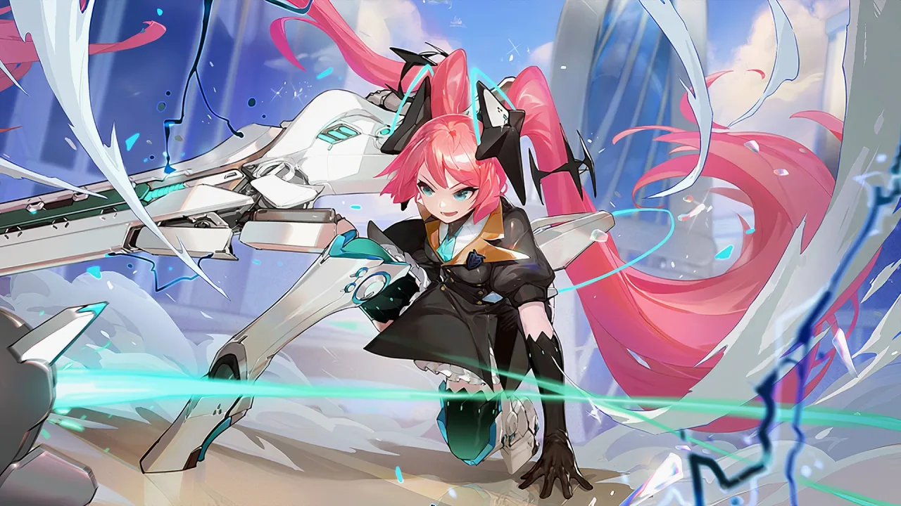

[Tier list](https://boostmlbb.ru/en/heroes/)[Items](https://boostmlbb.ru/en/items/)[Skins](https://boostmlbb.ru/en/skins/)[News & guides](https://boostmlbb.ru/en/news/)

[Skins](https://boostmlbb.ru/en/skins/)/[Layla](https://boostmlbb.ru/en/skins/layla.html)/Miss Hikari

[Layla skin](https://boostmlbb.ru/en/skins/layla.html)

# Miss Hikari

GrandThe AspirantsLimited

How to get

Released in the The Aspirants event. Limited skins come back in event draws from time to time.

Released

22 January 2022

## What the skin changes

-   New look
-   New skill effects
-   Skill sounds
-   Voice-over
-   Skill icons
-   Showcase animation
-   Showcase scene
-   Showcase music
-   Spawn animation
-   Special actions
-   Attribute bonus

## All Layla skins [12](https://boostmlbb.ru/en/skins/layla.html)

[Prismatic RhythmExquisite · 2026](https://boostmlbb.ru/en/skins/layla/prismatic-rhythm.html)[The BeaconSupreme · 2025](https://boostmlbb.ru/en/skins/layla/the-beacon.html)[Paranormal OperativeExquisite · 2024](https://boostmlbb.ru/en/skins/layla/paranormal-operative.html)[Twilight WaltzExceptional · 2023](https://boostmlbb.ru/en/skins/layla/twilight-waltz.html)[Miss HikariGrand · 2022](https://boostmlbb.ru/en/skins/layla/miss-hikari.html)[Blazing GunDeluxe · 2020](https://boostmlbb.ru/en/skins/layla/blazing-gun.html)[S.A.B.E.R. BreacherDeluxe · 2018](https://boostmlbb.ru/en/skins/layla/s-a-b-e-r-breacher.html)[Bunny BabeExceptional · 2017](https://boostmlbb.ru/en/skins/layla/bunny-babe.html)[Classic Malefic GunnerCommon · 2017](https://boostmlbb.ru/en/skins/layla/classic-malefic-gunner.html)[Blue SpectreCommon · 2017](https://boostmlbb.ru/en/skins/layla/blue-spectre.html)[Cannon and RosesExceptional · 2017](https://boostmlbb.ru/en/skins/layla/cannon-and-roses.html)[Green FlashCommon · 2016](https://boostmlbb.ru/en/skins/layla/green-flash.html)

## The Aspirants series

[Silverbolt RaikoSelena · 2026](https://boostmlbb.ru/en/skins/selena/silverbolt-raiko.html)[Imperatrix ArashiObsidia · 2026](https://boostmlbb.ru/en/skins/obsidia/imperatrix-arashi.html)[Daybreak HaloGuinevere · 2025](https://boostmlbb.ru/en/skins/guinevere/daybreak-halo.html)[Twilight StarVexana · 2025](https://boostmlbb.ru/en/skins/vexana/twilight-star.html)[Tech TensaiChang'e · 2024](https://boostmlbb.ru/en/skins/change/tech-tensai.html)[Deadeye SpectreLesley · 2024](https://boostmlbb.ru/en/skins/lesley/deadeye-spectre.html)[Mecha MaidenRuby · 2023](https://boostmlbb.ru/en/skins/ruby/mecha-maiden.html)[Blade of KibouFanny · 2022](https://boostmlbb.ru/en/skins/fanny/blade-of-kibou.html)

**Rank up on Layla**The calculator shows the price

[Calculate price](https://boostmlbb.ru/en/order.html?type=hero)

## Frequently asked questions

How to get the Miss Hikari skin for Layla?

Released in the The Aspirants event. Limited skins come back in event draws from time to time.

When was Miss Hikari released?

22 January 2022.

What class is Miss Hikari?

Grand, The Aspirants series.
