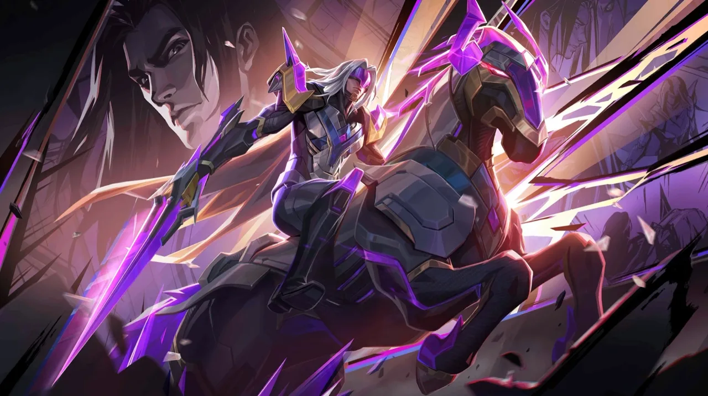

[Tier list](https://boostmlbb.ru/en/heroes/)[Items](https://boostmlbb.ru/en/items/)[Skins](https://boostmlbb.ru/en/skins/)[News & guides](https://boostmlbb.ru/en/news/)

[Skins](https://boostmlbb.ru/en/skins/)/[Leomord](https://boostmlbb.ru/en/skins/leomord.html)/Shadow Knight

[Leomord skin](https://boostmlbb.ru/en/skins/leomord.html)

# Shadow Knight

GrandABYSSLimited

How to get

Released in the ABYSS event. Limited skins come back in event draws from time to time.

Released

18 February 2023

## What the skin changes

-   New look
-   New skill effects
-   Skill sounds
-   Voice-over
-   Skill icons
-   Showcase animation
-   Showcase scene
-   Showcase music
-   Spawn animation
-   Special actions
-   Attribute bonus

## All Leomord skins [9](https://boostmlbb.ru/en/skins/leomord.html)

[Auspicious BlazeDeluxe · 2026](https://boostmlbb.ru/en/skins/leomord/auspicious-blaze.html)[Nightmare CountDeluxe · 2025](https://boostmlbb.ru/en/skins/leomord/nightmare-count.html)[Triumph - EagleExceptional · 2024](https://boostmlbb.ru/en/skins/leomord/triumph-eagle.html)[Diavel V4 RiderGrand · 2023](https://boostmlbb.ru/en/skins/leomord/diavel-v4-rider.html)[Shadow KnightGrand · 2023](https://boostmlbb.ru/en/skins/leomord/shadow-knight.html)[Hell KnightCommon · 2022](https://boostmlbb.ru/en/skins/leomord/hell-knight.html)[Jack-o'-lanternExceptional · 2020](https://boostmlbb.ru/en/skins/leomord/jack-o-lantern.html)[Inferno SoulExquisite · 2019](https://boostmlbb.ru/en/skins/leomord/inferno-soul.html)[Frostborn PaladinExceptional · 2019](https://boostmlbb.ru/en/skins/leomord/frostborn-paladin.html)

## ABYSS series

[Doom IncarnateMoskov · 2023](https://boostmlbb.ru/en/skins/moskov/doom-incarnate.html)[General VoidAlpha · 2023](https://boostmlbb.ru/en/skins/alpha/general-void.html)[Lady VengeanceSelena · 2021](https://boostmlbb.ru/en/skins/selena/lady-vengeance.html)

**Rank up on Leomord**The calculator shows the price

[Calculate price](https://boostmlbb.ru/en/order.html?type=hero)

## Frequently asked questions

How to get the Shadow Knight skin for Leomord?

Released in the ABYSS event. Limited skins come back in event draws from time to time.

When was Shadow Knight released?

18 February 2023.

What class is Shadow Knight?

Grand, ABYSS series.
