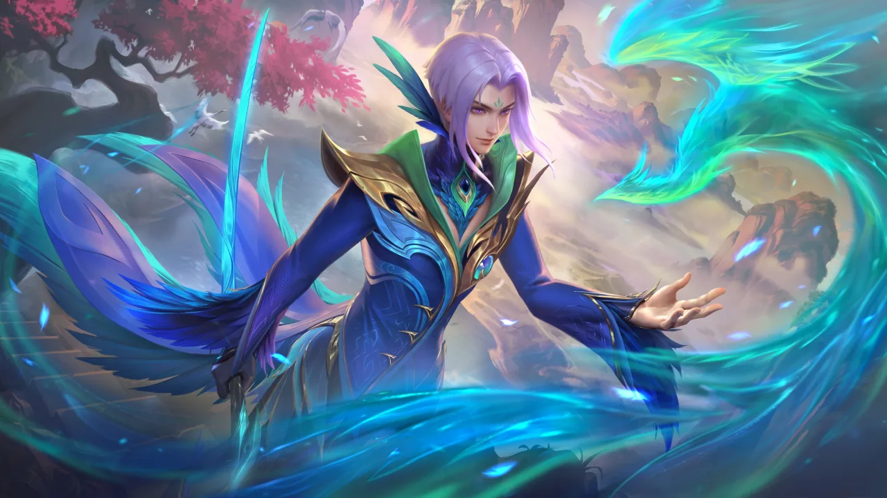

[All skins](https://boostmlbb.ru/en/skins/)

[Skins](https://boostmlbb.ru/en/skins/)/Ling

# Ling skins

Skins

8

In the shop

2

Latest

[Neobeast Ling](https://boostmlbb.ru/en/skins/ling/neobeast-ling.html)2025

[Hero profile→](https://boostmlbb.ru/en/heroes/ling.html)

## All skins

AllGrandExquisiteDeluxeExceptionalCommon

[Neobeast LingGrand · 2025](https://boostmlbb.ru/en/skins/ling/neobeast-ling.html)[Cosmo GuardExceptional · 2024](https://boostmlbb.ru/en/skins/ling/cosmo-guard.html)[Night ShadeDeluxe · 2024](https://boostmlbb.ru/en/skins/ling/night-shade.html)[Lord ShenGrand · 2022](https://boostmlbb.ru/en/skins/ling/lord-shen.html)[M-World LingDeluxe · 2022](https://boostmlbb.ru/en/skins/ling/m-world-ling.html)[Serene PlumeExquisite · 2021](https://boostmlbb.ru/en/skins/ling/serene-plume.html)[Street PunkExceptional · 2020](https://boostmlbb.ru/en/skins/ling/street-punk.html)[Fiery DanceCommon · 2019](https://boostmlbb.ru/en/skins/ling/fiery-dance.html)

**How much is a rank boost on Ling?**Choose your current and target ranks to see the price here.

[Calculate price](https://boostmlbb.ru/en/order.html?type=hero)

## Frequently asked questions

How many skins does Ling have?

8 skins, the default look not counted. The newest is Neobeast Ling (12 April 2025).

Which Ling skins can you buy now?

Night Shade (899 diamonds), Fiery Dance (269 diamonds). The other skins were limited and come back only in events.

What is the rarest Ling skin?

Neobeast Ling, Grand class, Neobeast 2 series. Released in the Neobeast 2 event. Limited skins come back in event draws from time to time.
