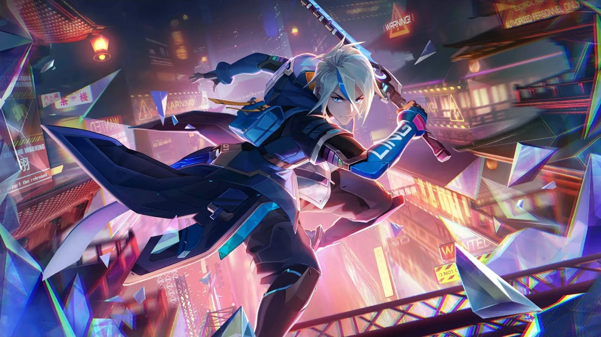

[Tier list](https://boostmlbb.ru/en/heroes/)[Items](https://boostmlbb.ru/en/items/)[Skins](https://boostmlbb.ru/en/skins/)[News & guides](https://boostmlbb.ru/en/news/)

[Skins](https://boostmlbb.ru/en/skins/)/[Ling](https://boostmlbb.ru/en/skins/ling.html)/M-World Ling

[Ling skin](https://boostmlbb.ru/en/skins/ling.html)

# M-World Ling

DeluxeM-WorldLimited

How to get

Released in the M-World event. Limited skins come back in event draws from time to time.

Released

23 April 2022

## What the skin changes

-   New look
-   New skill effects
-   Skill sounds
-   Voice-over
-   Showcase animation
-   Showcase scene
-   Attribute bonus

## All Ling skins [8](https://boostmlbb.ru/en/skins/ling.html)

[Neobeast LingGrand · 2025](https://boostmlbb.ru/en/skins/ling/neobeast-ling.html)[Cosmo GuardExceptional · 2024](https://boostmlbb.ru/en/skins/ling/cosmo-guard.html)[Night ShadeDeluxe · 2024](https://boostmlbb.ru/en/skins/ling/night-shade.html)[Lord ShenGrand · 2022](https://boostmlbb.ru/en/skins/ling/lord-shen.html)[M-World LingDeluxe · 2022](https://boostmlbb.ru/en/skins/ling/m-world-ling.html)[Serene PlumeExquisite · 2021](https://boostmlbb.ru/en/skins/ling/serene-plume.html)[Street PunkExceptional · 2020](https://boostmlbb.ru/en/skins/ling/street-punk.html)[Fiery DanceCommon · 2019](https://boostmlbb.ru/en/skins/ling/fiery-dance.html)

## M-World series

[M-World YinYin · 2022](https://boostmlbb.ru/en/skins/yin/m-world-yin.html)[M-World WanwanWanwan · 2022](https://boostmlbb.ru/en/skins/wanwan/m-world-wanwan.html)

**Rank up on Ling**The calculator shows the price

[Calculate price](https://boostmlbb.ru/en/order.html?type=hero)

## Frequently asked questions

How to get the M-World Ling skin for Ling?

Released in the M-World event. Limited skins come back in event draws from time to time.

When was M-World Ling released?

23 April 2022.

What class is M-World Ling?

Deluxe, M-World series.
