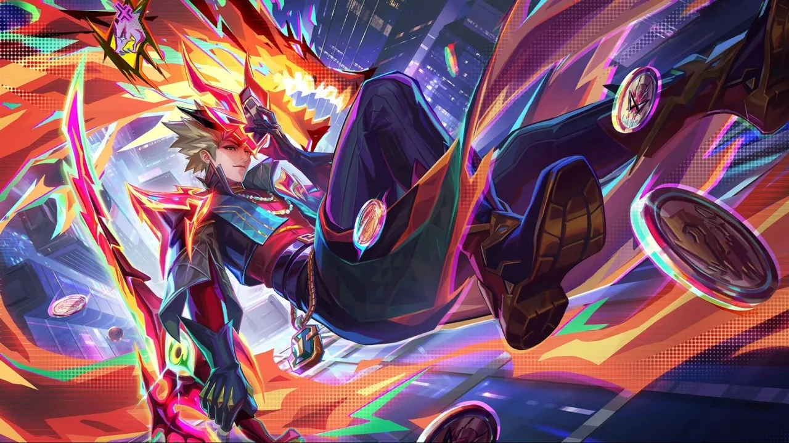

[Ling skins](https://boostmlbb.ru/en/skins/ling.html)

[Skins](https://boostmlbb.ru/en/skins/)/[Ling](https://boostmlbb.ru/en/skins/ling.html)/Neobeast Ling

[Ling skin](https://boostmlbb.ru/en/skins/ling.html)

# Neobeast Ling

GrandNeobeast 2Limited

How to get

Released in the Neobeast 2 event. Limited skins come back in event draws from time to time.

Released

12 April 2025

## What the skin changes

-   New look
-   New skill effects
-   Skill sounds
-   Voice-over
-   Skill icons
-   Showcase animation
-   Showcase scene
-   Showcase music
-   Spawn animation
-   Special actions
-   Attribute bonus

## All Ling skins [8](https://boostmlbb.ru/en/skins/ling.html)

[Neobeast LingGrand · 2025](https://boostmlbb.ru/en/skins/ling/neobeast-ling.html)[Cosmo GuardExceptional · 2024](https://boostmlbb.ru/en/skins/ling/cosmo-guard.html)[Night ShadeDeluxe · 2024](https://boostmlbb.ru/en/skins/ling/night-shade.html)[Lord ShenGrand · 2022](https://boostmlbb.ru/en/skins/ling/lord-shen.html)[M-World LingDeluxe · 2022](https://boostmlbb.ru/en/skins/ling/m-world-ling.html)[Serene PlumeExquisite · 2021](https://boostmlbb.ru/en/skins/ling/serene-plume.html)[Street PunkExceptional · 2020](https://boostmlbb.ru/en/skins/ling/street-punk.html)[Fiery DanceCommon · 2019](https://boostmlbb.ru/en/skins/ling/fiery-dance.html)

## Neobeast 2 series

[Neobeast PharsaPharsa · 2025](https://boostmlbb.ru/en/skins/pharsa/neobeast-pharsa.html)[Neobeast BrodyBrody · 2025](https://boostmlbb.ru/en/skins/brody/neobeast-brody.html)

**How much is a rank boost on Ling?**Choose your current and target ranks to see the price here.

[Calculate price](https://boostmlbb.ru/en/order.html?type=hero)

## Frequently asked questions

How to get the Neobeast Ling skin for Ling?

Released in the Neobeast 2 event. Limited skins come back in event draws from time to time.

When was Neobeast Ling released?

12 April 2025.

What class is Neobeast Ling?

Grand, Neobeast 2 series.
