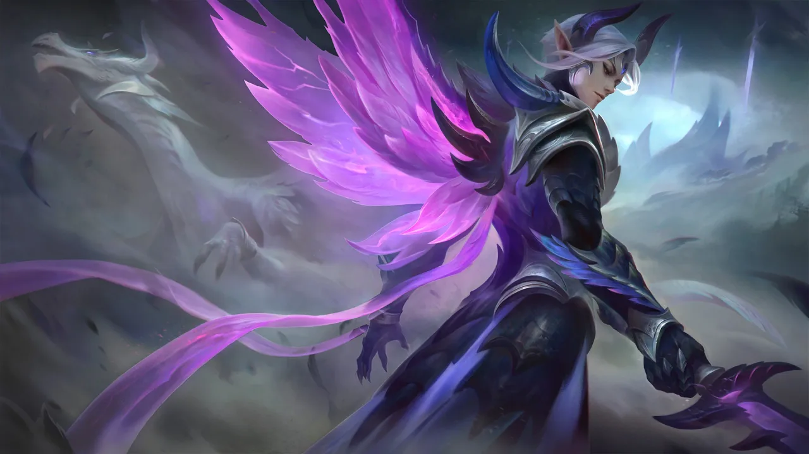

[Tier list](https://boostmlbb.ru/en/heroes/)[Items](https://boostmlbb.ru/en/items/)[Skins](https://boostmlbb.ru/en/skins/)[News & guides](https://boostmlbb.ru/en/news/)

[Skins](https://boostmlbb.ru/en/skins/)/[Ling](https://boostmlbb.ru/en/skins/ling.html)/Night Shade

[Ling skin](https://boostmlbb.ru/en/skins/ling.html)

# Night Shade

DeluxeDragon TamerIn the shop

How to get

Sold in the skin shop for 899 diamonds.

Price

899 diamonds

Released

13 February 2024

## What the skin changes

-   New look
-   New skill effects
-   Showcase animation
-   Showcase scene
-   Attribute bonus

## All Ling skins [8](https://boostmlbb.ru/en/skins/ling.html)

[Neobeast LingGrand · 2025](https://boostmlbb.ru/en/skins/ling/neobeast-ling.html)[Cosmo GuardExceptional · 2024](https://boostmlbb.ru/en/skins/ling/cosmo-guard.html)[Night ShadeDeluxe · 2024](https://boostmlbb.ru/en/skins/ling/night-shade.html)[Lord ShenGrand · 2022](https://boostmlbb.ru/en/skins/ling/lord-shen.html)[M-World LingDeluxe · 2022](https://boostmlbb.ru/en/skins/ling/m-world-ling.html)[Serene PlumeExquisite · 2021](https://boostmlbb.ru/en/skins/ling/serene-plume.html)[Street PunkExceptional · 2020](https://boostmlbb.ru/en/skins/ling/street-punk.html)[Fiery DanceCommon · 2019](https://boostmlbb.ru/en/skins/ling/fiery-dance.html)

## Dragon Tamer series

[Frost WingKimmy · 2025](https://boostmlbb.ru/en/skins/kimmy/frost-wing.html)[Empyrean FlameLancelot · 2021](https://boostmlbb.ru/en/skins/lancelot/empyrean-flame.html)[Dragon ArmorMasha · 2020](https://boostmlbb.ru/en/skins/masha/dragon-armor.html)[Draconic FlameValir · 2019](https://boostmlbb.ru/en/skins/valir/draconic-flame.html)[Rattan DragonEstes · 2017](https://boostmlbb.ru/en/skins/estes/rattan-dragon.html)

**Rank up on Ling**The calculator shows the price

[Calculate price](https://boostmlbb.ru/en/order.html?type=hero)

## Frequently asked questions

How to get the Night Shade skin for Ling?

Sold in the skin shop for 899 diamonds.

When was Night Shade released?

13 February 2024.

What class is Night Shade?

Deluxe, Dragon Tamer series.
