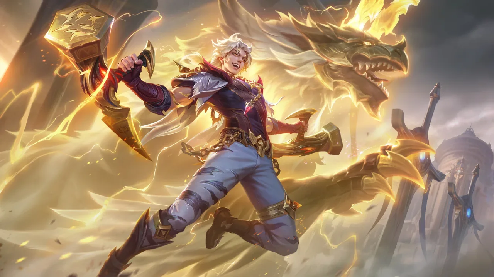

[Tier list](https://boostmlbb.ru/en/heroes/)[Items](https://boostmlbb.ru/en/items/)[Skins](https://boostmlbb.ru/en/skins/)[News & guides](https://boostmlbb.ru/en/news/)

[Skins](https://boostmlbb.ru/en/skins/)/Lukas

# Lukas skins

Skins

2

In the shop

1

Latest

[Naruto Uzumaki](https://boostmlbb.ru/en/skins/lukas/naruto-uzumaki.html)2025

[Hero profile→](https://boostmlbb.ru/en/heroes/lukas.html)

## All skins

[Naruto UzumakiGrand · 2025](https://boostmlbb.ru/en/skins/lukas/naruto-uzumaki.html)[Ardent RoarCommon · 2024](https://boostmlbb.ru/en/skins/lukas/ardent-roar.html)

**Rank up on Lukas**The calculator shows the price

[Calculate price](https://boostmlbb.ru/en/order.html?type=hero)

## Frequently asked questions

How many skins does Lukas have?

2 skins, the default look not counted. The newest is Naruto Uzumaki (2 May 2025).

Which Lukas skins can you buy now?

Ardent Roar (269 diamonds). The other skins were limited and come back only in events.

What is the rarest Lukas skin?

Naruto Uzumaki, Grand class, Naruto series. Released in the MLBB × Naruto collaboration event. Limited skins come back in event draws from time to time.
