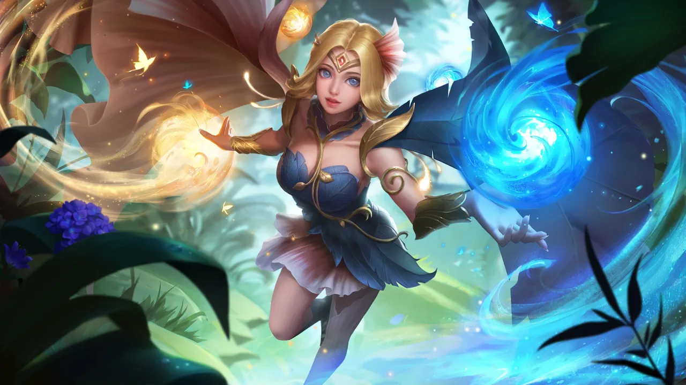

[Tier list](https://boostmlbb.ru/en/heroes/)[Items](https://boostmlbb.ru/en/items/)[Skins](https://boostmlbb.ru/en/skins/)[News & guides](https://boostmlbb.ru/en/news/)

[Skins](https://boostmlbb.ru/en/skins/)/[Lunox](https://boostmlbb.ru/en/skins/lunox.html)/Ash Blossom

[Lunox skin](https://boostmlbb.ru/en/skins/lunox.html)

# Ash Blossom

ExceptionalStarLightLimited

How to get

StarLight reward for May 2019.

Released

1 May 2019

## What the skin changes

-   New look
-   New skill effects
-   Showcase animation
-   Attribute bonus

## All Lunox skins [10](https://boostmlbb.ru/en/skins/lunox.html)

[Quantum PolarityExceptional · 2025](https://boostmlbb.ru/en/skins/lunox/quantum-polarity.html)[Butterfly SeraphimExquisite · 2025](https://boostmlbb.ru/en/skins/lunox/butterfly-seraphim.html)[Nature's HarmonyCommon · 2023](https://boostmlbb.ru/en/skins/lunox/nature-s-harmony.html)[Divine GoddessSupreme · 2023](https://boostmlbb.ru/en/skins/lunox/divine-goddess.html)[Bloody MaryCommon · 2022](https://boostmlbb.ru/en/skins/lunox/bloody-mary.html)[LibraDeluxe · 2019](https://boostmlbb.ru/en/skins/lunox/libra.html)[Dawn RevelationDeluxe · 2019](https://boostmlbb.ru/en/skins/lunox/dawn-revelation.html)[Eyes of EternityDeluxe · 2019](https://boostmlbb.ru/en/skins/lunox/eyes-of-eternity.html)[Ash BlossomExceptional · 2019](https://boostmlbb.ru/en/skins/lunox/ash-blossom.html)[Cosmic HarmonyCommon · 2019](https://boostmlbb.ru/en/skins/lunox/cosmic-harmony.html)

## StarLight series

[Tideborn SailorKalea · 2026](https://boostmlbb.ru/en/skins/kalea/tideborn-sailor.html)[Kitsune's ShadowHayabusa · 2026](https://boostmlbb.ru/en/skins/hayabusa/kitsune-s-shadow.html)[Fangs of SlaughterHanzo · 2026](https://boostmlbb.ru/en/skins/hanzo/fangs-of-slaughter.html)[Smoul­dering FortressBelerick · 2026](https://boostmlbb.ru/en/skins/belerick/smouldering-fortress.html)[Magitech WraithObsidia · 2026](https://boostmlbb.ru/en/skins/obsidia/magitech-wraith.html)[Elysian LuminanceZetian · 2026](https://boostmlbb.ru/en/skins/zetian/elysian-luminance.html)[Guardian BattalionHilda · 2026](https://boostmlbb.ru/en/skins/hilda/guardian-battalion.html)[Dreaming KoiHarley · 2026](https://boostmlbb.ru/en/skins/harley/dreaming-koi.html)

**Rank up on Lunox**The calculator shows the price

[Calculate price](https://boostmlbb.ru/en/order.html?type=hero)

## Frequently asked questions

How to get the Ash Blossom skin for Lunox?

StarLight reward for May 2019.

When was Ash Blossom released?

1 May 2019.

What class is Ash Blossom?

Exceptional, StarLight series.
