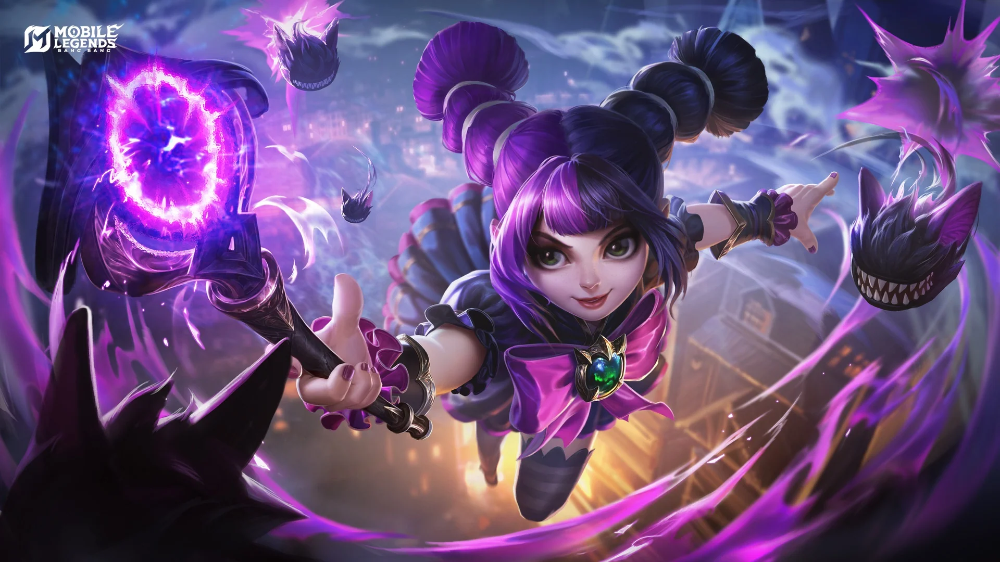

[Tier list](https://boostmlbb.ru/en/heroes/)[Items](https://boostmlbb.ru/en/items/)[Skins](https://boostmlbb.ru/en/skins/)[News & guides](https://boostmlbb.ru/en/news/)

[Skins](https://boostmlbb.ru/en/skins/)/Lylia

# Lylia skins

Skins

7

In the shop

4

Latest

[Phantasmal Revelry](https://boostmlbb.ru/en/skins/lylia/phantasmal-revelry.html)2026

[Hero profile→](https://boostmlbb.ru/en/heroes/lylia.html)

## All skins

AllGrandDeluxeExceptionalCommon

[Phantasmal RevelryDeluxe · 2026](https://boostmlbb.ru/en/skins/lylia/phantasmal-revelry.html)[Magitech ArsenalExceptional · 2024](https://boostmlbb.ru/en/skins/lylia/magitech-arsenal.html)[Neobeast LyliaGrand · 2023](https://boostmlbb.ru/en/skins/lylia/neobeast-lylia.html)[Haunted DollExceptional · 2020](https://boostmlbb.ru/en/skins/lylia/haunted-doll.html)[Future StarExceptional · 2020](https://boostmlbb.ru/en/skins/lylia/future-star.html)[Star StudentCommon · 2020](https://boostmlbb.ru/en/skins/lylia/star-student.html)[School IdolCommon · 2019](https://boostmlbb.ru/en/skins/lylia/school-idol.html)

**Rank up on Lylia**The calculator shows the price

[Calculate price](https://boostmlbb.ru/en/order.html?type=hero)

## Frequently asked questions

How many skins does Lylia have?

7 skins, the default look not counted. The newest is Phantasmal Revelry (3 March 2026).

Which Lylia skins can you buy now?

Haunted Doll (749 diamonds), Future Star (749 diamonds), Star Student (599 diamonds), School Idol (269 diamonds). The other skins were limited and come back only in events.

What is the rarest Lylia skin?

Neobeast Lylia, Grand class, Neobeast series. Released in the Neobeast event. Limited skins come back in event draws from time to time.
