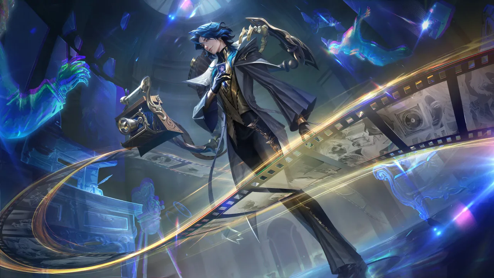
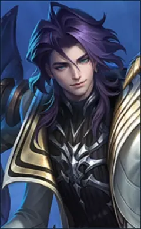

[All skins](https://boostmlbb.ru/en/skins/)

[Skins](https://boostmlbb.ru/en/skins/)/Marcel

# Marcel skins

Skins

1

In the shop

1

Latest

[Split Shadows](https://boostmlbb.ru/en/skins/marcel/split-shadows.html)2026

[Hero profile→](https://boostmlbb.ru/en/heroes/marcel.html)

## All skins

[Split ShadowsCommon · 2026](https://boostmlbb.ru/en/skins/marcel/split-shadows.html)

**How much is a rank boost on Marcel?**Choose your current and target ranks to see the price here.

[Calculate price](https://boostmlbb.ru/en/order.html?type=hero)

## Frequently asked questions

How many skins does Marcel have?

1 skin, the default look not counted. The newest is Split Shadows (21 March 2026).

Which Marcel skins can you buy now?

Split Shadows (269 diamonds). The other skins were limited and come back only in events.

What is the rarest Marcel skin?

Split Shadows, Common class. Sold in the skin shop for 269 diamonds.
