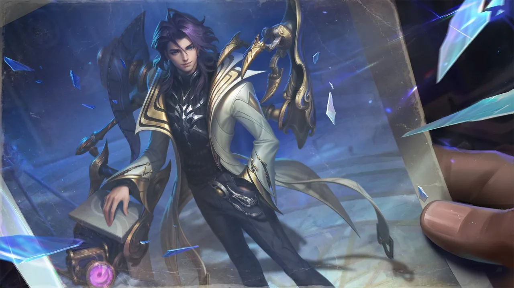

[Marcel skins](https://boostmlbb.ru/en/skins/marcel.html)

[Skins](https://boostmlbb.ru/en/skins/)/[Marcel](https://boostmlbb.ru/en/skins/marcel.html)/Split Shadows

[Marcel skin](https://boostmlbb.ru/en/skins/marcel.html)

# Split Shadows

CommonIn the shop

How to get

Sold in the skin shop for 269 diamonds.

Price

269 diamonds

Released

21 March 2026

## What the skin changes

-   Attribute bonus

**How much is a rank boost on Marcel?**Choose your current and target ranks to see the price here.

[Calculate price](https://boostmlbb.ru/en/order.html?type=hero)

## Frequently asked questions

How to get the Split Shadows skin for Marcel?

Sold in the skin shop for 269 diamonds.

When was Split Shadows released?

21 March 2026.

What class is Split Shadows?

Common.
