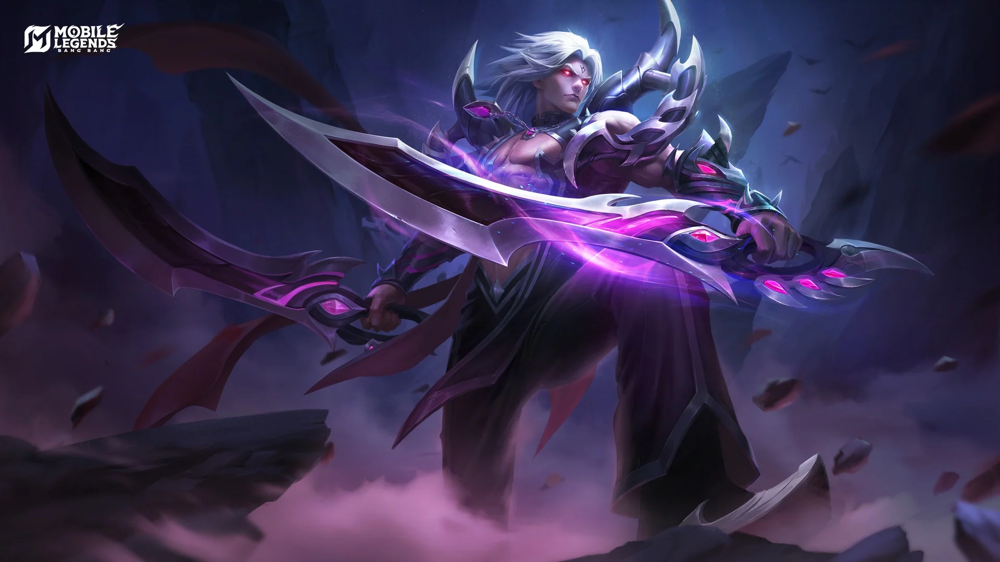

[Tier list](https://boostmlbb.ru/en/heroes/)[Items](https://boostmlbb.ru/en/items/)[Skins](https://boostmlbb.ru/en/skins/)[News & guides](https://boostmlbb.ru/en/news/)

[Skins](https://boostmlbb.ru/en/skins/)/Martis

# Martis skins

Skins

9

In the shop

1

Latest

[Warlord King](https://boostmlbb.ru/en/skins/martis/warlord-king.html)2025

[Hero profile→](https://boostmlbb.ru/en/heroes/martis.html)

## All skins

AllGrandExquisiteDeluxeExceptionalCommon

[Warlord KingCommon · 2025](https://boostmlbb.ru/en/skins/martis/warlord-king.html)[Darkwater TerrorExceptional · 2024](https://boostmlbb.ru/en/skins/martis/darkwater-terror.html)[LeviGrand · 2024](https://boostmlbb.ru/en/skins/martis/levi.html)[CapricornDeluxe · 2022](https://boostmlbb.ru/en/skins/martis/capricorn.html)[DeathrockExceptional · 2022](https://boostmlbb.ru/en/skins/martis/deathrock.html)[God of WarExquisite · 2020](https://boostmlbb.ru/en/skins/martis/god-of-war.html)[Searing MawExceptional · 2018](https://boostmlbb.ru/en/skins/martis/searing-maw.html)[TyrantCommon · 2018](https://boostmlbb.ru/en/skins/martis/tyrant.html)[Wild Renegade](https://boostmlbb.ru/en/skins/martis/wild-renegade.html)

**Rank up on Martis**The calculator shows the price

[Calculate price](https://boostmlbb.ru/en/order.html?type=hero)

## Frequently asked questions

How many skins does Martis have?

9 skins, the default look not counted. The newest is Warlord King (3 December 2025).

Which Martis skins can you buy now?

Tyrant (269 diamonds). The other skins were limited and come back only in events.

What is the rarest Martis skin?

Levi, Grand class, Attack on Titan series. Released in the MLBB × Attack on Titan collaboration event. Limited skins come back in event draws from time to time.
