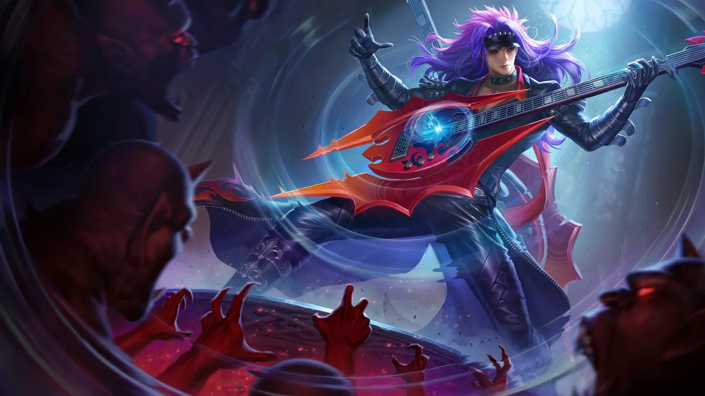

[Martis skins](https://boostmlbb.ru/en/skins/martis.html)

[Skins](https://boostmlbb.ru/en/skins/)/[Martis](https://boostmlbb.ru/en/skins/martis.html)/Deathrock

[Martis skin](https://boostmlbb.ru/en/skins/martis.html)

# Deathrock

ExceptionalSpecialLimited

How to get

Released in the skin shop during an event. Limited skins come back in event draws from time to time.

Released

6 January 2022

## What the skin changes

-   New look
-   New skill effects
-   Showcase animation
-   Attribute bonus

## All Martis skins [9](https://boostmlbb.ru/en/skins/martis.html)

[Warlord KingCommon · 2025](https://boostmlbb.ru/en/skins/martis/warlord-king.html)[Darkwater TerrorExceptional · 2024](https://boostmlbb.ru/en/skins/martis/darkwater-terror.html)[LeviGrand · 2024](https://boostmlbb.ru/en/skins/martis/levi.html)[CapricornDeluxe · 2022](https://boostmlbb.ru/en/skins/martis/capricorn.html)[DeathrockExceptional · 2022](https://boostmlbb.ru/en/skins/martis/deathrock.html)[God of WarExquisite · 2020](https://boostmlbb.ru/en/skins/martis/god-of-war.html)[Searing MawExceptional · 2018](https://boostmlbb.ru/en/skins/martis/searing-maw.html)[TyrantCommon · 2018](https://boostmlbb.ru/en/skins/martis/tyrant.html)[Wild Renegade](https://boostmlbb.ru/en/skins/martis/wild-renegade.html)

## Special series

[Arcane VerdictMathilda · 2026](https://boostmlbb.ru/en/skins/mathilda/arcane-verdict.html)[Windborne WaltzVale · 2026](https://boostmlbb.ru/en/skins/vale/windborne-waltz.html)[Captain of the LostFranco · 2026](https://boostmlbb.ru/en/skins/franco/captain-of-the-lost.html)[Waveb­reakerYi Sun-shin · 2025](https://boostmlbb.ru/en/skins/yi-sun-shin/wavebreaker.html)[Steel ArmsBadang · 2025](https://boostmlbb.ru/en/skins/badang/steel-arms.html)[Lady ParasolKagura · 2025](https://boostmlbb.ru/en/skins/kagura/lady-parasol.html)[Fathom TerrorAldous · 2025](https://boostmlbb.ru/en/skins/aldous/fathom-terror.html)[Moonglow TroupeChang'e · 2025](https://boostmlbb.ru/en/skins/change/moonglow-troupe.html)

**How much is a rank boost on Martis?**Choose your current and target ranks to see the price here.

[Calculate price](https://boostmlbb.ru/en/order.html?type=hero)

## Frequently asked questions

How to get the Deathrock skin for Martis?

Released in the skin shop during an event. Limited skins come back in event draws from time to time.

When was Deathrock released?

6 January 2022.

What class is Deathrock?

Exceptional, Special series.
