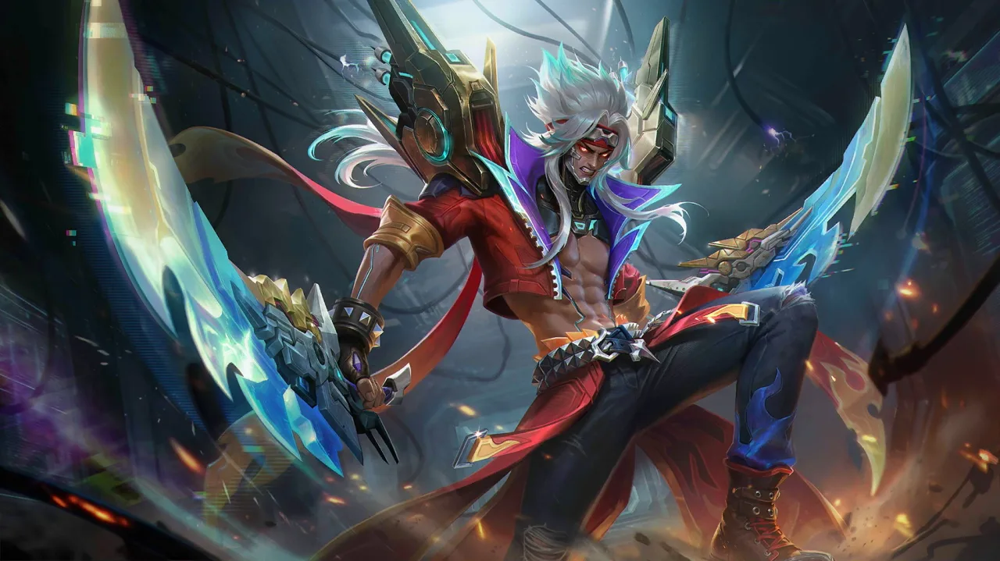

[Tier list](https://boostmlbb.ru/en/heroes/)[Items](https://boostmlbb.ru/en/items/)[Skins](https://boostmlbb.ru/en/skins/)[News & guides](https://boostmlbb.ru/en/news/)

[Skins](https://boostmlbb.ru/en/skins/)/[Martis](https://boostmlbb.ru/en/skins/martis.html)/Wild Renegade

[Martis skin](https://boostmlbb.ru/en/skins/martis.html)

# Wild Renegade

EpicIn the shop

How to get

Released in the skin shop during an event.

## All Martis skins [9](https://boostmlbb.ru/en/skins/martis.html)

[Warlord KingCommon · 2025](https://boostmlbb.ru/en/skins/martis/warlord-king.html)[Darkwater TerrorExceptional · 2024](https://boostmlbb.ru/en/skins/martis/darkwater-terror.html)[LeviGrand · 2024](https://boostmlbb.ru/en/skins/martis/levi.html)[CapricornDeluxe · 2022](https://boostmlbb.ru/en/skins/martis/capricorn.html)[DeathrockExceptional · 2022](https://boostmlbb.ru/en/skins/martis/deathrock.html)[God of WarExquisite · 2020](https://boostmlbb.ru/en/skins/martis/god-of-war.html)[Searing MawExceptional · 2018](https://boostmlbb.ru/en/skins/martis/searing-maw.html)[TyrantCommon · 2018](https://boostmlbb.ru/en/skins/martis/tyrant.html)[Wild Renegade](https://boostmlbb.ru/en/skins/martis/wild-renegade.html)

## Epic series

[Nether OverseerMinotaur · 2026](https://boostmlbb.ru/en/skins/minotaur/nether-overseer.html)[Sunken CurseAtlas · 2026](https://boostmlbb.ru/en/skins/atlas/sunken-curse.html)[Eternal VowVexana · 2026](https://boostmlbb.ru/en/skins/vexana/eternal-vow.html)[Cursed ScrollKhufra · 2025](https://boostmlbb.ru/en/skins/khufra/cursed-scroll.html)[Soul HuntressNatalia · 2025](https://boostmlbb.ru/en/skins/natalia/soul-huntress.html)[Nightmare CountLeomord · 2025](https://boostmlbb.ru/en/skins/leomord/nightmare-count.html)[Arbiter of StarsBelerick · 2025](https://boostmlbb.ru/en/skins/belerick/arbiter-of-stars.html)[Keeper of the WindsVale · 2025](https://boostmlbb.ru/en/skins/vale/keeper-of-the-winds.html)

**Rank up on Martis**The calculator shows the price

[Calculate price](https://boostmlbb.ru/en/order.html?type=hero)

## Frequently asked questions

How to get the Wild Renegade skin for Martis?

Released in the skin shop during an event.
