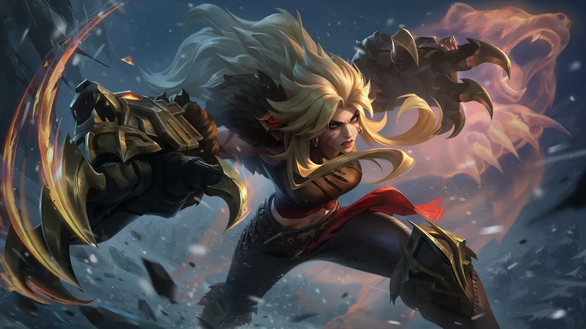

[Tier list](https://boostmlbb.ru/en/heroes/)[Items](https://boostmlbb.ru/en/items/)[Skins](https://boostmlbb.ru/en/skins/)[News & guides](https://boostmlbb.ru/en/news/)

[Skins](https://boostmlbb.ru/en/skins/)/Masha

# Masha skins

Skins

6

In the shop

2

Latest

[Mai Shiranui](https://boostmlbb.ru/en/skins/masha/mai-shiranui.html)2024

[Hero profile→](https://boostmlbb.ru/en/heroes/masha.html)

## All skins

[Mai ShiranuiGrand · 2024](https://boostmlbb.ru/en/skins/masha/mai-shiranui.html)[Rogue TalonExceptional · 2022](https://boostmlbb.ru/en/skins/masha/rogue-talon.html)[Spirited GauntletCommon · 2020](https://boostmlbb.ru/en/skins/masha/spirited-gauntlet.html)[Dragon ArmorDeluxe · 2020](https://boostmlbb.ru/en/skins/masha/dragon-armor.html)[Combat MaidenExceptional · 2020](https://boostmlbb.ru/en/skins/masha/combat-maiden.html)[Winter GuardCommon · 2019](https://boostmlbb.ru/en/skins/masha/winter-guard.html)

**Rank up on Masha**The calculator shows the price

[Calculate price](https://boostmlbb.ru/en/order.html?type=hero)

## Frequently asked questions

How many skins does Masha have?

6 skins, the default look not counted. The newest is Mai Shiranui (24 April 2024).

Which Masha skins can you buy now?

Dragon Armor (899 diamonds), Winter Guard (269 diamonds). The other skins were limited and come back only in events.

What is the rarest Masha skin?

Mai Shiranui, Grand class, KOF series. Released in the MLBB × KOF collaboration event. Limited skins come back in event draws from time to time.
