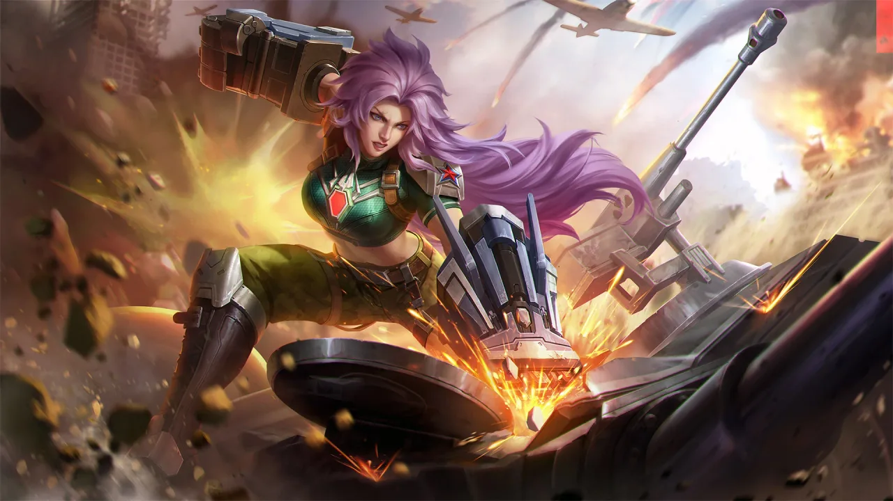
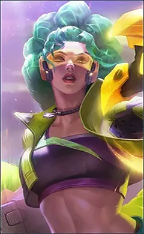
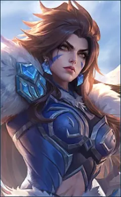

[Tier list](https://boostmlbb.ru/en/heroes/)[Items](https://boostmlbb.ru/en/items/)[Skins](https://boostmlbb.ru/en/skins/)[News & guides](https://boostmlbb.ru/en/news/)

[Skins](https://boostmlbb.ru/en/skins/)/[Masha](https://boostmlbb.ru/en/skins/masha.html)/Combat Maiden

[Masha skin](https://boostmlbb.ru/en/skins/masha.html)

# Combat Maiden

ExceptionalStarLightLimited

How to get

StarLight reward for February 2020.

Released

1 February 2020

## What the skin changes

-   New look
-   New skill effects
-   Showcase animation
-   Attribute bonus

## All Masha skins [6](https://boostmlbb.ru/en/skins/masha.html)

[Mai ShiranuiGrand · 2024](https://boostmlbb.ru/en/skins/masha/mai-shiranui.html)[Rogue TalonExceptional · 2022](https://boostmlbb.ru/en/skins/masha/rogue-talon.html)[Spirited GauntletCommon · 2020](https://boostmlbb.ru/en/skins/masha/spirited-gauntlet.html)[Dragon ArmorDeluxe · 2020](https://boostmlbb.ru/en/skins/masha/dragon-armor.html)[Combat MaidenExceptional · 2020](https://boostmlbb.ru/en/skins/masha/combat-maiden.html)[Winter GuardCommon · 2019](https://boostmlbb.ru/en/skins/masha/winter-guard.html)

## StarLight series

[Tideborn SailorKalea · 2026](https://boostmlbb.ru/en/skins/kalea/tideborn-sailor.html)[Kitsune's ShadowHayabusa · 2026](https://boostmlbb.ru/en/skins/hayabusa/kitsune-s-shadow.html)[Fangs of SlaughterHanzo · 2026](https://boostmlbb.ru/en/skins/hanzo/fangs-of-slaughter.html)[Smoul­dering FortressBelerick · 2026](https://boostmlbb.ru/en/skins/belerick/smouldering-fortress.html)[Magitech WraithObsidia · 2026](https://boostmlbb.ru/en/skins/obsidia/magitech-wraith.html)[Elysian LuminanceZetian · 2026](https://boostmlbb.ru/en/skins/zetian/elysian-luminance.html)[Guardian BattalionHilda · 2026](https://boostmlbb.ru/en/skins/hilda/guardian-battalion.html)[Dreaming KoiHarley · 2026](https://boostmlbb.ru/en/skins/harley/dreaming-koi.html)

**Rank up on Masha**The calculator shows the price

[Calculate price](https://boostmlbb.ru/en/order.html?type=hero)

## Frequently asked questions

How to get the Combat Maiden skin for Masha?

StarLight reward for February 2020.

When was Combat Maiden released?

1 February 2020.

What class is Combat Maiden?

Exceptional, StarLight series.
