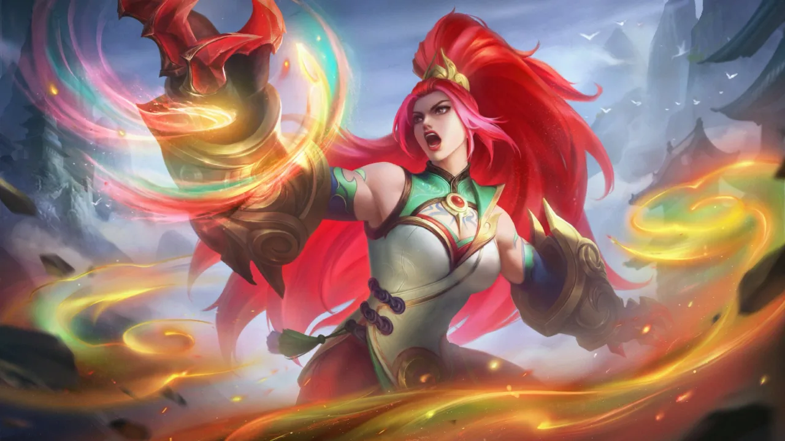

[Masha skins](https://boostmlbb.ru/en/skins/masha.html)

[Skins](https://boostmlbb.ru/en/skins/)/[Masha](https://boostmlbb.ru/en/skins/masha.html)/Rogue Talon

[Masha skin](https://boostmlbb.ru/en/skins/masha.html)

# Rogue Talon

ExceptionalSpecialLimited

How to get

Released in the skin shop during an event. Limited skins come back in event draws from time to time.

Released

28 November 2022

## What the skin changes

-   New look
-   New skill effects
-   Showcase animation
-   Attribute bonus

## All Masha skins [6](https://boostmlbb.ru/en/skins/masha.html)

[Mai ShiranuiGrand · 2024](https://boostmlbb.ru/en/skins/masha/mai-shiranui.html)[Rogue TalonExceptional · 2022](https://boostmlbb.ru/en/skins/masha/rogue-talon.html)[Spirited GauntletCommon · 2020](https://boostmlbb.ru/en/skins/masha/spirited-gauntlet.html)[Dragon ArmorDeluxe · 2020](https://boostmlbb.ru/en/skins/masha/dragon-armor.html)[Combat MaidenExceptional · 2020](https://boostmlbb.ru/en/skins/masha/combat-maiden.html)[Winter GuardCommon · 2019](https://boostmlbb.ru/en/skins/masha/winter-guard.html)

## Special series

[Arcane VerdictMathilda · 2026](https://boostmlbb.ru/en/skins/mathilda/arcane-verdict.html)[Windborne WaltzVale · 2026](https://boostmlbb.ru/en/skins/vale/windborne-waltz.html)[Captain of the LostFranco · 2026](https://boostmlbb.ru/en/skins/franco/captain-of-the-lost.html)[Waveb­reakerYi Sun-shin · 2025](https://boostmlbb.ru/en/skins/yi-sun-shin/wavebreaker.html)[Steel ArmsBadang · 2025](https://boostmlbb.ru/en/skins/badang/steel-arms.html)[Lady ParasolKagura · 2025](https://boostmlbb.ru/en/skins/kagura/lady-parasol.html)[Fathom TerrorAldous · 2025](https://boostmlbb.ru/en/skins/aldous/fathom-terror.html)[Moonglow TroupeChang'e · 2025](https://boostmlbb.ru/en/skins/change/moonglow-troupe.html)

**How much is a rank boost on Masha?**Choose your current and target ranks to see the price here.

[Calculate price](https://boostmlbb.ru/en/order.html?type=hero)

## Frequently asked questions

How to get the Rogue Talon skin for Masha?

Released in the skin shop during an event. Limited skins come back in event draws from time to time.

When was Rogue Talon released?

28 November 2022.

What class is Rogue Talon?

Exceptional, Special series.
