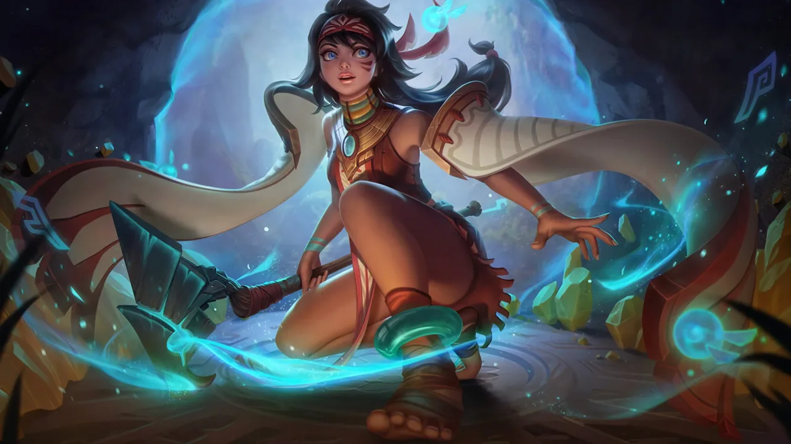

[All skins](https://boostmlbb.ru/en/skins/)

[Skins](https://boostmlbb.ru/en/skins/)/Mathilda

# Mathilda skins

Skins

5

In the shop

2

Latest

[Arcane Verdict](https://boostmlbb.ru/en/skins/mathilda/arcane-verdict.html)2026

[Hero profile→](https://boostmlbb.ru/en/heroes/mathilda.html)

## All skins

[Arcane VerdictExceptional · 2026](https://boostmlbb.ru/en/skins/mathilda/arcane-verdict.html)[Dreambound PixieDeluxe · 2025](https://boostmlbb.ru/en/skins/mathilda/dreambound-pixie.html)[Dream GrooveExceptional · 2022](https://boostmlbb.ru/en/skins/mathilda/dream-groove.html)[Floral CrownCommon · 2021](https://boostmlbb.ru/en/skins/mathilda/floral-crown.html)[Unrestrai­ned DelightCommon · 2020](https://boostmlbb.ru/en/skins/mathilda/unrestrained-delight.html)

**How much is a rank boost on Mathilda?**Choose your current and target ranks to see the price here.

[Calculate price](https://boostmlbb.ru/en/order.html?type=hero)

## Frequently asked questions

How many skins does Mathilda have?

5 skins, the default look not counted. The newest is Arcane Verdict (19 September 2026).

Which Mathilda skins can you buy now?

Dream Groove (749 diamonds), Unrestrained Delight (269 diamonds). The other skins were limited and come back only in events.

What is the rarest Mathilda skin?

Dreambound Pixie, Deluxe class, Epic series. Released in the skin shop during an event. Limited skins come back in event draws from time to time.
