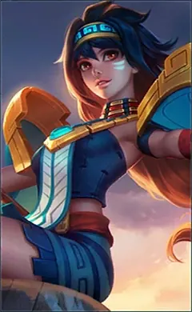

[Mathilda skins](https://boostmlbb.ru/en/skins/mathilda.html)

[Skins](https://boostmlbb.ru/en/skins/)/[Mathilda](https://boostmlbb.ru/en/skins/mathilda.html)/Dream Groove

[Mathilda skin](https://boostmlbb.ru/en/skins/mathilda.html)

# Dream Groove

ExceptionalMPLIn the shop

How to get

Sold in the skin shop for 749 diamonds.

Price

749 diamonds

Released

24 February 2022

## What the skin changes

-   New look
-   New skill effects
-   Showcase animation
-   Attribute bonus

## All Mathilda skins [5](https://boostmlbb.ru/en/skins/mathilda.html)

[Arcane VerdictExceptional · 2026](https://boostmlbb.ru/en/skins/mathilda/arcane-verdict.html)[Dreambound PixieDeluxe · 2025](https://boostmlbb.ru/en/skins/mathilda/dreambound-pixie.html)[Dream GrooveExceptional · 2022](https://boostmlbb.ru/en/skins/mathilda/dream-groove.html)[Floral CrownCommon · 2021](https://boostmlbb.ru/en/skins/mathilda/floral-crown.html)[Unrestrai­ned DelightCommon · 2020](https://boostmlbb.ru/en/skins/mathilda/unrestrained-delight.html)

## MPL series

[Quantum CommandoBadang · 2026](https://boostmlbb.ru/en/skins/badang/quantum-commando.html)[Quantum PolarityLunox · 2025](https://boostmlbb.ru/en/skins/lunox/quantum-polarity.html)[Prismatic SentinelEdith · 2025](https://boostmlbb.ru/en/skins/edith/prismatic-sentinel.html)[Quantum VanguardFranco · 2024](https://boostmlbb.ru/en/skins/franco/quantum-vanguard.html)[Quantum EdgeBenedetta · 2024](https://boostmlbb.ru/en/skins/benedetta/quantum-edge.html)[Hydro­mancerKadita · 2023](https://boostmlbb.ru/en/skins/kadita/hydromancer.html)[Cyber RangerJawhead · 2023](https://boostmlbb.ru/en/skins/jawhead/cyber-ranger.html)[Quantum GripBrody · 2023](https://boostmlbb.ru/en/skins/brody/quantum-grip.html)

**How much is a rank boost on Mathilda?**Choose your current and target ranks to see the price here.

[Calculate price](https://boostmlbb.ru/en/order.html?type=hero)

## Frequently asked questions

How to get the Dream Groove skin for Mathilda?

Sold in the skin shop for 749 diamonds.

When was Dream Groove released?

24 February 2022.

What class is Dream Groove?

Exceptional, MPL series.
