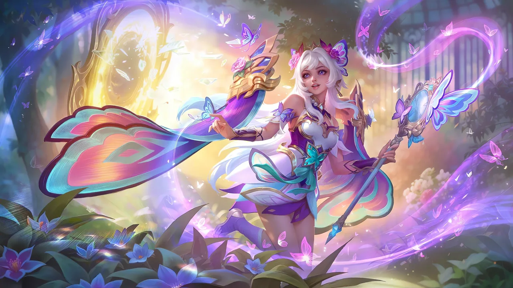

[Mathilda skins](https://boostmlbb.ru/en/skins/mathilda.html)

[Skins](https://boostmlbb.ru/en/skins/)/[Mathilda](https://boostmlbb.ru/en/skins/mathilda.html)/Dreambound Pixie

[Mathilda skin](https://boostmlbb.ru/en/skins/mathilda.html)

# Dreambound Pixie

DeluxeEpicLimited

How to get

Released in the skin shop during an event. Limited skins come back in event draws from time to time.

Released

3 March 2025

## What the skin changes

-   New look
-   New skill effects
-   Skill sounds
-   Showcase animation
-   Showcase scene
-   Showcase music
-   Attribute bonus

## All Mathilda skins [5](https://boostmlbb.ru/en/skins/mathilda.html)

[Arcane VerdictExceptional · 2026](https://boostmlbb.ru/en/skins/mathilda/arcane-verdict.html)[Dreambound PixieDeluxe · 2025](https://boostmlbb.ru/en/skins/mathilda/dreambound-pixie.html)[Dream GrooveExceptional · 2022](https://boostmlbb.ru/en/skins/mathilda/dream-groove.html)[Floral CrownCommon · 2021](https://boostmlbb.ru/en/skins/mathilda/floral-crown.html)[Unrestrai­ned DelightCommon · 2020](https://boostmlbb.ru/en/skins/mathilda/unrestrained-delight.html)

## Epic series

[Nether OverseerMinotaur · 2026](https://boostmlbb.ru/en/skins/minotaur/nether-overseer.html)[Sunken CurseAtlas · 2026](https://boostmlbb.ru/en/skins/atlas/sunken-curse.html)[Eternal VowVexana · 2026](https://boostmlbb.ru/en/skins/vexana/eternal-vow.html)[Cursed ScrollKhufra · 2025](https://boostmlbb.ru/en/skins/khufra/cursed-scroll.html)[Soul HuntressNatalia · 2025](https://boostmlbb.ru/en/skins/natalia/soul-huntress.html)[Nightmare CountLeomord · 2025](https://boostmlbb.ru/en/skins/leomord/nightmare-count.html)[Arbiter of StarsBelerick · 2025](https://boostmlbb.ru/en/skins/belerick/arbiter-of-stars.html)[Keeper of the WindsVale · 2025](https://boostmlbb.ru/en/skins/vale/keeper-of-the-winds.html)

**How much is a rank boost on Mathilda?**Choose your current and target ranks to see the price here.

[Calculate price](https://boostmlbb.ru/en/order.html?type=hero)

## Frequently asked questions

How to get the Dreambound Pixie skin for Mathilda?

Released in the skin shop during an event. Limited skins come back in event draws from time to time.

When was Dreambound Pixie released?

3 March 2025.

What class is Dreambound Pixie?

Deluxe, Epic series.
